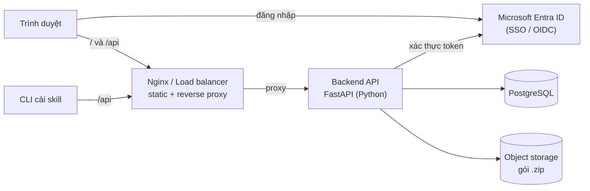
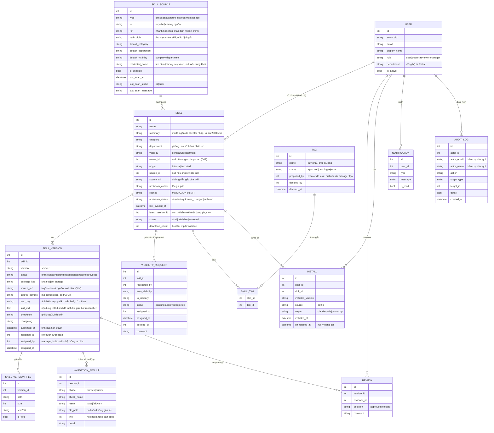
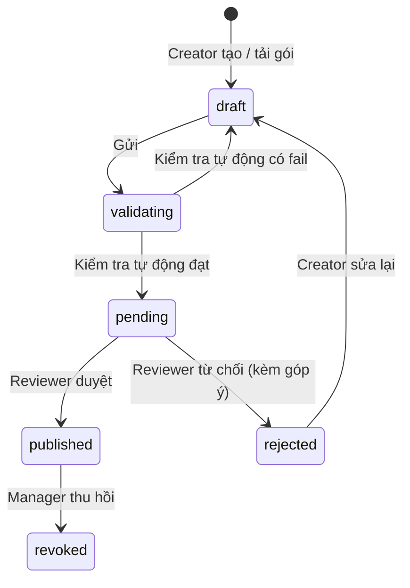
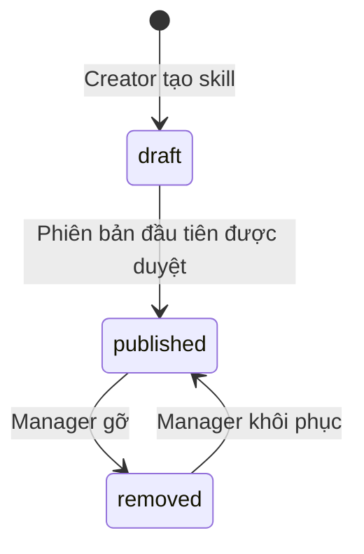
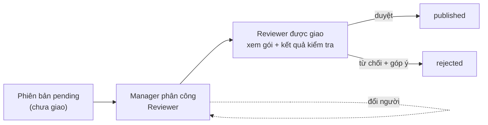
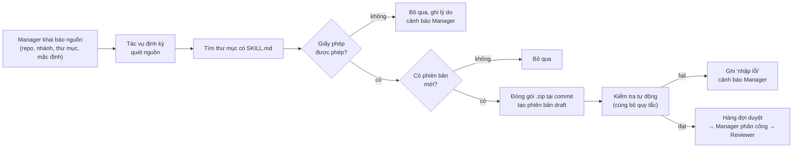
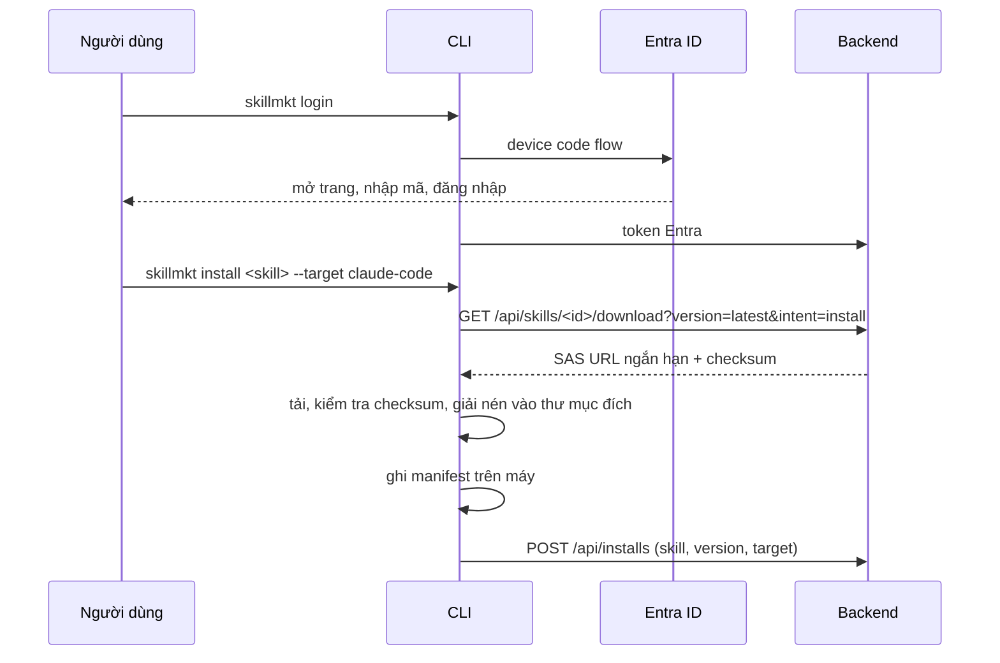
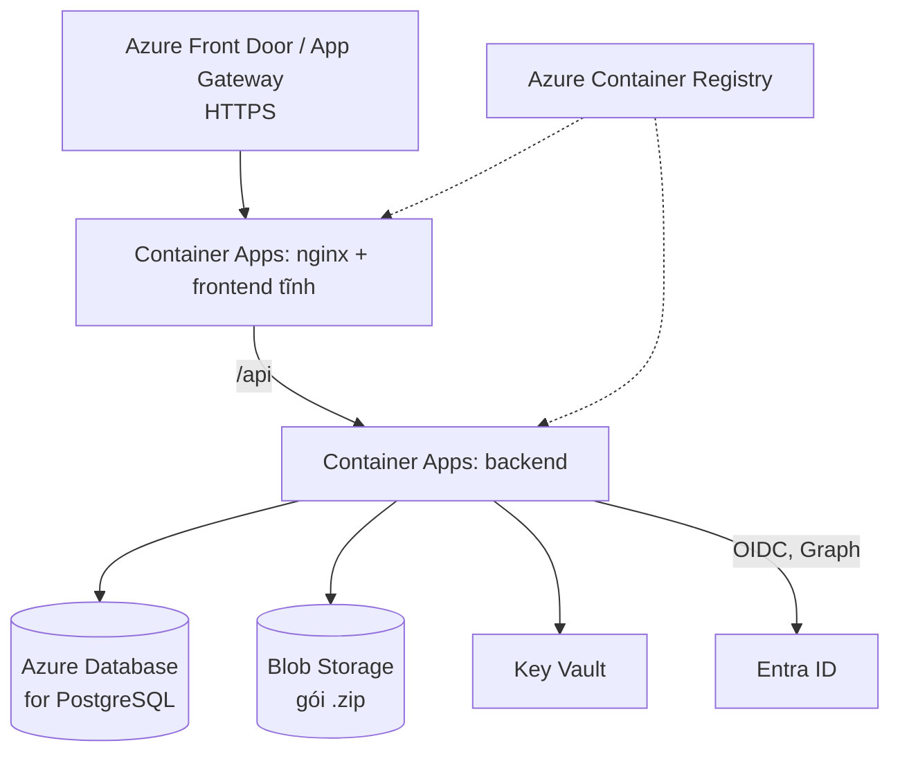

# Kiến trúc – Skill Marketplace nội bộ

> Trạng thái: **thiết kế mục tiêu.** Các file trong `backend/` hiện mới là khung rỗng và `frontend/` chưa được tạo; tài liệu này mô tả cấu trúc và cách các phần sẽ nối với nhau. Yêu cầu nghiệp vụ xem `website/PLAN.md` (bản cũ trong git history). Danh sách API xem [api.md](api.md).

## 0. Các quyết định đã chốt

| # | Chủ đề | Quyết định | Hệ quả thiết kế |
|---|---|---|---|
| D1 | Vai trò | Mỗi người **một** vai trò: User, Creator, Reviewer, Manager | Cột `role` đơn trong bảng `users`; không cần bảng gán nhiều vai trò |
| D2 | Đăng nhập & vai trò | **SSO Microsoft Entra ID** (OIDC); vai trò lấy từ **nhóm Entra ID** | Không lưu mật khẩu; IT/Manager gán người vào nhóm Entra, hệ thống không có màn hình gán vai trò |
| D3 | Triển khai | **Azure** | Container Apps, Azure Database for PostgreSQL, Blob Storage, Key Vault; Managed Identity thay cho khóa truy cập |
| D4 | Nội dung skill | Thư mục file đóng gói `.zip`, **kiểm tra tự động** trước khi vào hàng đợi duyệt | Có bước validate và bảng kết quả kiểm tra |
| D5 | Lưu vết | **Nhật ký kiểm toán đầy đủ** | Bảng `audit_logs` ghi mọi thao tác duyệt, gỡ, chuyển quyền, khôi phục (người thực hiện có thể là hệ thống) |
| D6 | Thông báo | **Chỉ trên website** | Bảng `notifications`, không cần dịch vụ email/hàng đợi |
| D7 | Phân loại & tìm kiếm | Danh mục + phòng ban + **thẻ (tag)**; tìm kiếm full-text | Bảng `tags`, `skill_tags`; tìm kiếm văn bản của PostgreSQL trên tên, mô tả, tag |
| D8 | Phiên bản | **Semantic version** do Creator điền (ví dụ `1.2.0`) | Chặn số nhỏ hơn hoặc trùng bản trước; so sánh để cảnh báo cập nhật |
| D9 | Khôi phục phiên bản | Chỉ đổi con trỏ bản "mới nhất", **cảnh báo** người đã cài | Phiên bản bị thu hồi có trạng thái `revoked`; không tự ghi đè máy người dùng |
| D10 | Gỡ skill | **Gỡ mềm**: ẩn khỏi tìm kiếm, giữ dữ liệu, cảnh báo người đã cài | Không xoá gói/bản ghi; có thể khôi phục |
| D11 | Trạng thái cài | CLI **lưu trên máy và báo về server** | Máy giữ file danh sách cài; server giữ bảng `installs` để cảnh báo cập nhật/gỡ/thu hồi |
| D12 | Cập nhật | **Người dùng tự chạy lệnh cập nhật** | CLI chỉ báo có bản mới, không tự ghi đè |
| D13 | Công cụ đích | **Claude Code, Cursor**, và **chỉ tải .zip** | CLI có `--target`; mỗi target có thư mục mặc định riêng |
| D14 | Mức chặn kiểm tra | **Chặn hẳn lỗi nghiêm trọng, cảnh báo lỗi nhẹ** | Mỗi kiểm tra có mức `fail`/`warn`; chỉ `fail` chặn gửi duyệt |
| D15 | Giới hạn gói | **Cấu hình được** (mặc định 10 MB, 200 file) | Giá trị trong cấu hình, không hard-code |
| D16 | Số người duyệt | **1 Reviewer** là đủ | Một bản ghi `reviews` quyết định trạng thái; không cần đếm phiếu |
| D17 | Quyền Reviewer | **Không sửa gói**, chỉ duyệt hoặc từ chối kèm góp ý | Gói bất biến sau khi gửi; từ chối bắt buộc có góp ý |
| D18 | Quá hạn duyệt | **Cảnh báo quá hạn** cho Reviewer và Manager | Ngưỡng cấu hình (mặc định 5 ngày làm việc, theo lịch D31); không tự động đăng |
| D19 | Phạm vi xem skill | **Creator chọn khi đăng**: công khai toàn công ty hoặc chỉ phòng ban | Trường `skills.visibility`; backend lọc theo phòng ban ở mọi truy vấn và tải |
| D20 | Phòng ban của người dùng | Lấy từ thuộc tính **`department` của Entra ID** | Cột `users.department` đồng bộ mỗi lần đăng nhập |
| D21 | Thống kê | **Đếm lượt cài**, hiện công khai trên thẻ skill | Chỉ số, không lộ danh tính; dùng xếp hạng "nổi bật" |
| D22 | Sao lưu | Chấp nhận mất tối đa **24 giờ** dữ liệu (RPO) | Sao lưu tự động hằng ngày của Azure, kèm bảo vệ xoá cho Blob |
| D23 | Entra ngừng hoạt động | **Phiên đang có dùng tiếp**, người mới phải chờ | Phiên có hạn; cache khoá công khai (JWKS); không có tài khoản khẩn cấp riêng |
| D24 | Cảnh báo sự cố | **Email cho nhóm vận hành** qua Azure Monitor | Một hộp thư nhóm nhận cảnh báo; không cần webhook chat |
| D25 | Tải gói & kiểm tra | **Tải gói lên qua backend** (multipart) và **kiểm tra đồng bộ** trong request (cả lúc tải gói để xem trước, D42, và lúc gửi duyệt) | Không cần worker/hàng đợi; gói giới hạn 10 MB nên xử lý trong vài giây |
| D26 | Phân công duyệt | **Manager phân công** Reviewer cụ thể cho từng phiên bản chờ duyệt | Không có cơ chế claim; `assigned_to`/`assigned_at`; Reviewer chỉ thấy việc được giao |
| D27 | Đổi phạm vi xem | **Thu hẹp áp dụng ngay, mở rộng phải duyệt lại** | Mở rộng tạo `visibility_requests` đi qua cùng hàng đợi và phân công |
| D28 | Manager không kịp giao | Quá **1 ngày** chưa giao → nhắc Manager; quá **3 ngày làm việc** → **tự động chia vòng** | Cần một tác vụ định kỳ (không phải worker xử lý hàng đợi); ngưỡng cấu hình được |
| D29 | CLI | Viết bằng **Node.js**, phát hành qua **kho npm nội bộ** của công ty | Thư mục `cli/` riêng trong repo; pipeline build/publish riêng; người dùng cần Node.js |
| D30 | Quản lý tag | **Chọn từ danh sách tag có sẵn**; Creator có thể **đề xuất tag mới** cho Manager duyệt | Tag có trạng thái `approved/pending/rejected`; Manager kiểm soát từ vựng; thay cho "tag tự do" của D7 |
| D31 | Ngày làm việc | **Thứ hai đến thứ sáu; thứ bảy làm xen kẽ (cách tuần)**; bỏ ngày lễ theo danh sách cấu hình | Dùng chung cho mọi ngưỡng "ngày làm việc" (D18, D28) |
| D32 | Script & quy tắc quét | **Cho phép script** trong skill; chỉ **chặn mẫu nguy hiểm rõ ràng**, còn lại cảnh báo. Quy tắc nằm ở **file cấu hình trong repo**, người triển khai sửa | Thay đổi quy tắc có review/lịch sử Git; không có màn hình sửa quy tắc, không có ngoại lệ theo skill |
| D33 | RTO & lưu nhật ký | Ngừng tối đa **vài giờ trong ngày làm việc** (RTO); giữ nhật ký kiểm toán **3 năm** hoặc theo quy định công ty nếu dài hơn | Không cần hạ tầng dự phòng chủ động; đặt `AUDIT_RETENTION_YEARS` trong cấu hình, mặc định 3 |
| D34 | Frontend | **React + TypeScript + Vite**, một trang động (SPA) | Có bước build; nginx phục vụ file build và trả `index.html` cho mọi đường dẫn giao diện |
| D35 | Thư viện UI | **Material UI (MUI)** | Theme tập trung; thẻ skill, bảng, form, modal dùng thành phần MUI |
| D36 | Ngôn ngữ giao diện | **Tiếng Việt và tiếng Anh** | `react-i18next`, hai bộ chuỗi `vi`, `en`; mặc định theo trình duyệt |
| D37 | Giao diện màu | **Sáng + tối**, màu thương hiệu cấu hình được | File theme riêng; theo cài đặt máy, có nút đổi và nhớ lựa chọn |
| D38 | Bố cục trang chủ | Theo bố cục trang marketplace của Qoder: banner, tab danh mục, các khối xếp dọc có "Xem tất cả", khối kêu gọi đóng góp, chân trang | Trang chủ là nhiều khối độc lập, mỗi khối một truy vấn |
| D39 | Biểu tượng skill | **Creator tải ảnh lên**, ảnh **gắn vào phiên bản** và được Reviewer xem khi duyệt | `skill_versions.icon_key`; đổi ảnh = phiên bản mới; backend chuẩn hoá ảnh và phục vụ qua endpoint có kiểm tra quyền |
| D40 | Trang chi tiết skill | Hướng dẫn cài **theo tab công cụ** có lệnh sao chép được; mô tả gồm **mô tả ngắn do Creator nhập** + **nội dung `SKILL.md` trong gói** | `skills.summary`, `skill_versions.skill_md`; Markdown được làm sạch trước khi hiển thị |
| D41 | Trang "Skill của tôi" | **Lưới thẻ** giống trang chủ; người **chỉ tải .zip** vẫn có skill trong danh sách (nguồn `zip`) để nhận cảnh báo | `installs.source = cli\|zip`; lượt cài công khai chỉ đếm nguồn `cli` |
| D42 | Luồng tạo skill (Studio) | **Wizard 3 bước**: Gói → Thông tin → Xem lại & Gửi; kiểm tra tự động chạy **ngay khi tải gói** (xem trước) và **chạy lại khi Gửi** (chính thức) | Tải gói tạo ngay bản nháp; `validation_results.phase = preview\|submit`; `POST /api/skills` trả kết quả kiểm tra và dữ liệu điền sẵn |
| D43 | Trang quản trị | **Bảng điều khiển** mở đầu với việc cần làm; gỡ/thu hồi **bắt buộc nhập lý do** và hộp xác nhận nêu **số người bị ảnh hưởng**; nhật ký **xuất CSV** theo bộ lọc | `GET /api/admin/dashboard`, `GET .../impact`, `GET /api/admin/audit-logs/export`; việc xuất cũng ghi nhật ký |
| D44 | Màn hình duyệt | Reviewer **xem gói ngay trên web** (cây file + nội dung từng file) và xem **diff theo file so với bản đang phục vụ** | Bảng `skill_version_files` (danh sách file, băm); nội dung lấy theo yêu cầu từ gói; hiển thị dạng văn bản thuần, không dựng HTML |
| D45 | Nguồn skill | Ngoài Creator, skill còn **thu thập từ nguồn ngoài**: GitHub (repo công khai), kho nội bộ công ty (GitLab, Azure DevOps...), marketplace công khai khác (làm sau) | Module `sources` với bộ kết nối theo loại nguồn; `skills.origin = internal\|imported` |
| D46 | Cách thu thập | **Manager khai báo danh sách nguồn**, hệ thống **quét định kỳ** | Bảng `skill_sources`; tác vụ định kỳ dùng chung hạ tầng với D28 |
| D47 | Duyệt skill thu thập | **Đi cùng quy trình như skill của Creator**: kiểm tra tự động → Manager phân công → Reviewer duyệt | Không có đường đăng thẳng; mọi phiên bản mới từ nguồn đều chờ duyệt |
| D48 | Chủ skill thu thập | **Không có chủ cá nhân**: ghi tác giả gốc, **Manager quản lý** | `skills.owner_id` có thể rỗng; nội dung chỉ đến từ nguồn, không ai trong công ty sửa |
| D49 | Phiên bản từ nguồn | Dùng **tag/release semver** nếu có; không thì **mã commit** để sinh số nội bộ `0.0.N` | `skill_versions.source_ref`, `source_commit`; vẫn tuân quy tắc semver D8 |
| D50 | Giấy phép | **Chỉ nhập khi giấy phép nằm trong danh sách cho phép** (MIT, Apache-2.0, BSD...) | Danh sách cấu hình trong repo; hiển thị giấy phép và nguồn trên trang skill |
| D51 | Nguồn thay đổi | Nguồn gốc bị xoá/đổi giấy phép/đóng → **giữ bản đã duyệt, cảnh báo Manager** quyết định gỡ | `skills.upstream_status`; hiện trên bảng điều khiển quản trị |

## 1. Tổng quan

Website nội bộ để nhân viên **tìm, cài và cập nhật skill**. Skill đi qua quy trình Creator tạo → kiểm tra tự động → Reviewer duyệt → đăng → User cài.



## 2. Thành phần

| Thành phần | Thư mục | Vai trò |
|---|---|---|
| Frontend | `frontend/` | Ứng dụng React một trang, chia theo tính năng, gọi API qua một client chung |
| Backend | `backend/app/` | REST API, nghiệp vụ, phân quyền |
| Reverse proxy | `deploy/nginx/default.conf` | Phục vụ file tĩnh, chuyển `/api` sang backend |
| Đóng gói | `docker-compose.yml`, `deploy/docker-compose.prod.yml`, `backend/Dockerfile` | Chạy dev và production |
| Migration | `backend/alembic.ini` | Quản lý schema DB |
| Cấu hình | `.env`, `.env.example`, `backend/.env.example` | Biến môi trường (`.env` không commit) |

## 3. Backend

Python/FastAPI, kiểu **modular monolith**: mỗi module là một lát nghiệp vụ độc lập, có cùng bố cục.

```
backend/app/
├── main.py              # tạo app, đăng ký router, middleware, exception handler
├── core/                # hạ tầng dùng chung
│   ├── config.py        #   đọc biến môi trường
│   ├── database.py      #   engine/session
│   ├── security.py      #   xác thực token Entra (JWKS), phát session
│   ├── dependencies.py  #   dependency chung (db session, current user)
│   ├── exceptions.py    #   exception gốc + handler
│   └── logging.py
├── shared/              # pagination.py, utils.py
└── modules/
    ├── auth/            # đăng nhập SSO, đổi code lấy token, /me
    ├── users/           # tài khoản; vai trò và phòng ban đồng bộ từ Entra
    ├── skills/          # skill, phiên bản, danh mục, tag, tìm kiếm, kiểm tra tự động, ảnh biểu tượng, cấp SAS URL tải gói
    ├── reviews/         # hàng đợi duyệt, phân công, quyết định duyệt (phiên bản và yêu cầu đổi phạm vi xem)
    ├── installs/        # bản ghi skill đã cài, trạng thái cập nhật/thu hồi/gỡ
    ├── sources/         # khai báo nguồn, bộ kết nối GitHub/GitLab/Azure DevOps, quét và nhập skill (D45)
    └── admin/           # gỡ, khôi phục, chuyển quyền sở hữu, thu hồi phiên bản, duyệt/gộp tag, bảng điều khiển, nhật ký
```

Các module `notifications` (D6) và `audit` (D5) đã được thêm vào cùng `shared/workcalendar` (D31); `jobs/scheduled.py` là điểm vào của tác vụ định kỳ (D28). Tag và yêu cầu đổi phạm vi xem không có module riêng: nằm trong `skills` và `reviews`. Module `reviews` chỉ gọi `skills` qua `skills/review_api.py`.

### Phân tầng trong mỗi module

```
router.py  →  service.py  →  repository.py  →  models.py (DB)
   │             │
schemas.py    exceptions.py
```

| File | Trách nhiệm | Không được làm |
|---|---|---|
| `router.py` | Định nghĩa endpoint, validate qua `schemas.py`, gọi service | Chứa nghiệp vụ, truy vấn DB |
| `service.py` | Nghiệp vụ, kiểm tra quyền/trạng thái, ném exception của module | Biết về HTTP |
| `repository.py` | Truy vấn DB | Chứa nghiệp vụ |
| `models.py` | Bảng ORM | – |
| `schemas.py` | Request/response (Pydantic) | – |
| `exceptions.py` | Lỗi nghiệp vụ riêng của module | – |

`auth` và `admin` không có `models.py`/`repository.py` vì dùng lại model của `users` và `skills`.

Quy tắc phụ thuộc: module chỉ gọi **service** của module khác, không import repository/model của module khác; `core/` và `shared/` không import từ `modules/`.

## 4. Đăng nhập (SSO Entra ID)

```mermaid
sequenceDiagram
    participant U as Trình duyệt
    participant A as Backend
    participant E as Entra ID
    U->>A: GET /api/auth/login
    A-->>U: redirect tới Entra (authorization code + PKCE)
    U->>E: đăng nhập công ty
    E-->>U: redirect về /api/auth/callback?code=...
    U->>A: code
    A->>E: đổi code lấy ID token, kiểm tra chữ ký
    A->>A: đọc claim groups, suy ra role; tìm/tạo user theo oid, cập nhật role
    A-->>U: cookie session (httpOnly)
```

Backend nhận **hai đường xác thực**, cùng đi qua một dependency `current user`:

| Đường | Dùng bởi | Cách xác thực |
|---|---|---|
| Cookie session | Website | Backend tự phát sau luồng trên; hết hạn theo cấu hình |
| `Authorization: Bearer` | CLI | Access token của Entra (audience là API của website); backend kiểm tra chữ ký bằng JWKS |

Ở cả hai đường, vai trò và phòng ban được suy ra từ claim và đồng bộ vào `users` (đường Bearer đồng bộ khi token mới được thấy lần đầu, có cache ngắn để không ghi DB mỗi request).

- Backend **không lưu mật khẩu**. Định danh bằng `oid` của Entra, `email` để hiển thị.
- Lần đăng nhập đầu tạo tài khoản trong DB (để gắn với skill, bản cài, thông báo).
- **Vai trò lấy từ nhóm Entra ID**, đồng bộ mỗi lần đăng nhập (xem bảng dưới); cột `users.role` chỉ là bản sao để truy vấn nhanh.
- Không ở nhóm nào thì mặc định `user`.

| Nhóm Entra (tên giả định) | Vai trò |
|---|---|
| `skillmkt-managers` | manager |
| `skillmkt-reviewers` | reviewer |
| `skillmkt-creators` | creator |
| (không nhóm nào) | user |

Quy tắc khi một người ở nhiều nhóm (D1: chỉ một vai trò): lấy vai trò **cao nhất** theo thứ tự manager > reviewer > creator > user. Khuyến nghị IT không xếp một người vào nhiều nhóm, để tránh Manager vô tình có quyền duyệt skill của chính mình.

Lưu ý kỹ thuật: ID token chỉ chứa tối đa khoảng 200 nhóm; nếu người dùng ở nhiều nhóm hơn, Entra trả "groups overage" và backend phải gọi Microsoft Graph để lấy nhóm. Nên dùng cấu hình "nhóm gán cho ứng dụng" (chỉ phát nhóm đã gán cho app) để tránh tình huống này.

- **Phòng ban** lấy từ thuộc tính `department` của người dùng trong Entra ID, đồng bộ mỗi lần đăng nhập. Cần bật claim `department` hoặc gọi Microsoft Graph (`/me`) nếu token không có.
- Nhân viên nghỉ việc: Entra chặn đăng nhập; tài khoản trong DB đặt `is_active = false`.

## 5. Mô hình dữ liệu (dự kiến)



`audit_logs` chỉ thêm, không sửa/xoá. Ghi cho: duyệt/từ chối, gỡ, khôi phục, thu hồi phiên bản, chuyển quyền sở hữu, và khi vai trò của một người thay đổi do đồng bộ từ nhóm Entra.

## 6. Phân quyền

Vai trò lấy từ DB sau khi xác thực; kiểm tra bằng dependency ở `modules/auth/dependencies.py`.

| Nhóm endpoint | User | Creator | Reviewer | Manager |
|---|---|---|---|---|
| Xem/tìm skill đã đăng, cài, tải .zip (theo phạm vi xem) | ✓ | ✓ | ✓ | ✓ |
| Tạo/gửi skill, đề xuất tag mới | ✗ | ✓ | ✗ | ✗ |
| Xem và quyết định duyệt việc **được giao** | ✗ | ✗ | ✓ | ✗ |
| Xem toàn bộ hàng đợi, **phân công** người duyệt | ✗ | ✗ | ✗ | ✓ |
| Gỡ skill, khôi phục, thu hồi phiên bản, chuyển quyền sở hữu, duyệt/gộp tag, xem và xuất nhật ký | ✗ | ✗ | ✗ | ✓ |
| Khai báo và quản lý nguồn thu thập, quét thủ công, sửa thông tin skill thu thập | ✗ | ✗ | ✗ | ✓ |

**Chuyển quyền sở hữu**: chỉ chuyển cho người đang có vai trò Creator. Nếu chủ skill nghỉ việc hoặc mất vai trò Creator, skill vẫn phục vụ bình thường; Manager chuyển cho người khác khi cần sửa hoặc phát hành bản mới.

Vì mỗi người một vai trò (D1), Reviewer không thể tạo skill nên không có tình huống tự duyệt skill của mình. Frontend ẩn trang theo vai trò chỉ để thuận tiện; **backend luôn là nơi chặn quyền thật**.

### Phạm vi xem skill (D19, D20)

| `visibility` | Ai thấy và cài được |
|---|---|
| `company` | Mọi nhân viên đã đăng nhập |
| `department` | Chỉ người có `users.department` trùng `skills.department`; ngoài ra Creator là chủ skill, Reviewer (khi duyệt) và Manager |

- Lọc nằm ở **backend** cho mọi đường: tìm kiếm, danh mục, trang chủ, chi tiết, tải `.zip`, cấp SAS URL, cài bằng CLI và kiểm tra cập nhật. Không đủ quyền thì trả 404 (không lộ sự tồn tại của skill).
- Người bị đổi phòng ban: skill đã cài vẫn nằm trên máy, nhưng không nhận cập nhật và không cài mới các skill của phòng ban cũ.
- Tên phòng ban phải khớp chính xác với `department` trong Entra; cần danh sách phòng ban chuẩn (lấy từ Entra hoặc cấu hình) để Creator chọn thay vì gõ tay, tránh sai chính tả làm skill biến mất với đúng người.

## 7. Vòng đời skill

Quy trình gửi và duyệt thuộc về **phiên bản**, không phải skill. Nhờ vậy một phiên bản mới bị kiểm tra lỗi hay bị từ chối **không làm skill đang phục vụ biến mất**.

**Phiên bản** (`skill_versions.status`):



**Skill** (`skills.status`), chỉ ba trạng thái:

| Trạng thái | Ý nghĩa |
|---|---|
| `draft` | Chưa có phiên bản nào được đăng; chỉ chủ skill thấy |
| `published` | Có ít nhất một phiên bản `published`; `latest_version_id` trỏ tới bản đang phục vụ |
| `removed` | Manager gỡ mềm; ẩn khỏi người dùng nhưng giữ dữ liệu |



Mỗi chuyển trạng thái do service thực hiện, đồng thời ghi `audit_logs` (nếu do Reviewer/Manager) và tạo `notifications` cho chủ skill.

### Quy tắc phiên bản (D8, D9)

- Số phiên bản theo semver `MAJOR.MINOR.PATCH`; phải **lớn hơn** mọi phiên bản `published` hoặc `revoked` của skill đó. Số của bản `draft`/`rejected` chưa từng đăng thì dùng lại được.
- Chỉ phiên bản `published` mới được cài. `latest_version_id` trỏ tới bản `published` cao nhất.
- Phiên bản đang chờ duyệt không ảnh hưởng người dùng; bản cũ vẫn được phục vụ.
- **Thu hồi / khôi phục về bản trước** (Manager): đặt bản lỗi thành `revoked`, `latest_version_id` trỏ lại bản `published` gần nhất còn tốt. Người đã cài bản `revoked` nhận thông báo và cảnh báo ở "Skill của tôi"; hệ thống **không** tự gỡ hay ghi đè bản trên máy họ.
- Bản `revoked` không bao giờ được cấp lại cho lượt cài mới; Creator muốn sửa phải phát hành số phiên bản mới.
- Không thu hồi được phiên bản `published` **cuối cùng** của skill (trả `409`): khi đó Manager dùng **gỡ skill** để giữ bất biến "skill `published` luôn có ít nhất một bản `published`".

### Gỡ skill (D10)

- Manager đặt skill thành `removed`: ẩn khỏi trang chủ, tìm kiếm, danh mục; chặn cài mới và tải `.zip`.
- Gói, các phiên bản, lịch sử duyệt và nhật ký **được giữ nguyên**; trang chi tiết chỉ còn mở được cho chủ skill và Manager.
- Người đã cài nhận thông báo và cảnh báo "skill đã bị gỡ" ở "Skill của tôi" để tự gỡ khỏi máy.
- Khôi phục đưa skill về `published` với `latest_version_id` như trước khi gỡ (trừ phiên bản đã `revoked`).

### Lượt cài và skill nổi bật (D21)

- **Số lượt cài** = số người dùng khác nhau hiện đang có skill đó (bản ghi `installs` có `uninstalled_at` rỗng). Một người cài lại hoặc cập nhật không làm tăng số.
- Hiện trên thẻ skill và trang chi tiết; chỉ hiện con số, không hiện ai đã cài.
- Chỉ đếm cài qua CLI (`installs.source = cli`). Tải `.zip` từ website tăng số **lượt tải** (`skills.download_count`) và tạo bản ghi `installs` với `source = zip`, nhưng **không cộng vào lượt cài** công khai vì không biết có đặt vào máy thật hay không. Bản ghi `zip` vẫn dùng để cảnh báo thu hồi/gỡ (D41).
- "Skill nổi bật" ở trang chủ xếp theo lượt cài trong 30 ngày gần đây, cộng thêm skill mới đăng để skill mới có cơ hội xuất hiện.
- Với skill `department`, con số chỉ phản ánh người trong phòng ban đó.
- Không có dashboard chi tiết trong phạm vi này (theo phiên bản, theo thời gian); có thể thêm sau nếu cần.

### Phân loại & tìm kiếm (D7, D30)

- Mỗi skill có đúng 1 **danh mục**, 1 **phòng ban**, và 0–N **tag** (tối đa khoảng 10).
- **Tag lấy từ danh sách đã duyệt (`approved`)**. Form tạo skill gợi ý và cho chọn từ danh sách; gõ để lọc.
- Creator không tìm thấy tag phù hợp thì **đề xuất tag mới**: tag được tạo với trạng thái `pending`, gắn tạm vào skill, và chờ Manager duyệt.

| Trạng thái tag | Hiển thị | Khi Manager quyết định |
|---|---|---|
| `approved` | Hiện ở bộ lọc, gợi ý, thẻ skill | – |
| `pending` | Chỉ chủ skill và Manager thấy; **không** hiện ở tìm kiếm/bộ lọc của người khác | Duyệt → thành `approved`, tự hiện trên skill |
| `rejected` | Gỡ khỏi skill | Từ chối kèm lý do; Creator nhận thông báo, có thể chọn tag khác |

- Tag đang `pending` **không chặn** việc gửi duyệt và đăng skill; skill vẫn đăng bình thường, chỉ thiếu tag đó cho tới khi được duyệt.
- Chuẩn hoá khi đề xuất: chữ thường, bỏ khoảng trắng thừa; nếu trùng (không phân biệt hoa thường) hoặc rất giống tag đã có, giao diện gợi ý dùng tag có sẵn thay vì tạo mới.
- Manager còn **gộp** tag trùng (chuyển mọi skill từ tag cũ sang tag đúng) và **ẩn/xoá** tag không còn dùng; thao tác ghi `audit_logs`.
- Tìm kiếm dùng full-text của PostgreSQL trên tên, mô tả, tag; lọc theo danh mục, phòng ban, tag.
- Chỉ trả về skill `published` và người dùng có quyền xem (D19).
- Hệ quả: Manager có thêm một hàng việc duyệt tag. Vì chỉ phát sinh khi cần tag mới nên nhẹ hơn việc phân công duyệt skill.

### Quy trình duyệt (D16–D18, D26)



- Phiên bản vào hàng đợi sau khi kiểm tra tự động không có `fail` (`submitted_at` được ghi), ở trạng thái **chưa giao**. Manager nhận thông báo và thấy toàn bộ hàng đợi.
- **Manager phân công** một Reviewer cho từng phiên bản (ghi `assigned_to`, `assigned_at`); có thể **giao lại** cho người khác khi Reviewer nghỉ, quá tải hoặc quá hạn. Reviewer chỉ thấy và quyết định được việc **được giao cho mình**.
- Manager **không** duyệt thay (D1: mỗi người một vai trò); chỉ phân công và đôn đốc.
- Reviewer xem gói, kết quả kiểm tra tự động (kể cả `warn`), rồi chọn **duyệt** hoặc **từ chối kèm góp ý bắt buộc**. Không sửa gói.
- Gói bất biến sau khi gửi: `checksum` được ghi lúc gửi và kiểm tra lại lúc đăng, để bảo đảm bản được duyệt chính là bản được phát.
- Một quyết định của 1 Reviewer là đủ: duyệt → phiên bản `published` (và skill `published` nếu đây là bản đầu); từ chối → phiên bản `rejected`, Creator nhận thông báo kèm góp ý và sửa lại ở trạng thái `draft`.
- **Quá hạn:** phiên bản ở hàng đợi quá ngưỡng (mặc định 5 ngày làm việc kể từ `submitted_at`) được đánh dấu quá hạn, hiện nổi bật cho Manager và Reviewer được giao, kèm thông báo trên website. Phiên bản **chưa giao** quá một ngày làm việc cũng bị đánh dấu để Manager không bỏ sót. Hệ thống **không tự đăng**.
- **Manager không kịp giao (D28):**

| Thời gian chưa giao (tính từ `submitted_at`) | Hệ thống làm gì |
|---|---|
| Quá 1 ngày làm việc | Đánh dấu "chưa giao quá hạn", gửi thông báo nhắc **mọi Manager**; không tự giao |
| Quá 3 ngày làm việc | **Tự động chia vòng**: giao cho Reviewer đang hoạt động có ít việc đang giữ nhất (hòa thì người được giao lần cuối lâu nhất) |

  - Việc tự giao được ghi `audit_logs` với người thực hiện là **hệ thống**, và thông báo Reviewer được giao cùng Manager.
  - Manager vẫn giao lại được sau khi hệ thống đã chia.
  - Nếu không có Reviewer nào (nhóm trống hoặc tất cả bị vô hiệu hoá), giữ nguyên chưa giao và gửi cảnh báo cho Manager.
  - Hai ngưỡng (1 ngày, 3 ngày) và lịch ngày làm việc nằm trong cấu hình.
  - Tự động chia chỉ chạy qua một **tác vụ định kỳ** (mục 10), không phải khi người dùng truy cập.

### Lịch ngày làm việc (D31)

Mọi ngưỡng tính theo "ngày làm việc" (quá hạn duyệt 5 ngày, nhắc Manager 1 ngày, tự chia 3 ngày) dùng chung một lịch:

| Ngày | Có tính là ngày làm việc? |
|---|---|
| Thứ hai đến thứ sáu | Có |
| Thứ bảy | **Cách tuần**: tuần làm thứ bảy thì có, tuần nghỉ thì không (tuần nghỉ thứ bảy coi như tuần kết thúc ở thứ sáu) |
| Chủ nhật | Không |
| Ngày lễ trong danh sách cấu hình | Không |

- Cấu hình gồm: **ngày mốc** của một thứ bảy làm việc (từ đó suy ra các thứ bảy làm việc kế tiếp cách mỗi 14 ngày), danh sách ngày lễ theo năm, và múi giờ (mặc định đề xuất `Asia/Ho_Chi_Minh`).
- Ngày được tính theo ngày lịch trong múi giờ đó, kể từ thời điểm `submitted_at`: một "ngày" trôi qua khi sang ngày làm việc kế tiếp.
- Danh sách ngày lễ nằm trong file cấu hình, người triển khai cập nhật mỗi năm (nhờ Manager nhắc); nếu quên thì hệ thống coi ngày lễ là ngày thường, nên nhắc/tự chia có thể diễn ra sớm.
- Một module nhỏ `shared/workcalendar` (hàm cộng/đếm ngày làm việc) dùng chung cho kiểm tra quá hạn, nhắc Manager và tự chia.

### Ảnh biểu tượng (D39)

- Ảnh thuộc về **phiên bản**: tải kèm gói (hoặc thay khi phiên bản còn `draft`), được kiểm tra tự động và được Reviewer thấy khi duyệt. Muốn đổi ảnh của skill đã đăng thì phát hành phiên bản mới; trong lúc chờ duyệt, thẻ vẫn dùng ảnh của bản `published` hiện tại.
- Ảnh nằm trong Blob **riêng với gói `.zip`** (không nhét vào gói), để gói giữ nguyên `checksum` và để CLI không phải tải ảnh.
- Quy tắc tải lên (cấu hình được): định dạng PNG, JPEG, WebP; tối đa 512 KB; tối thiểu 128×128 px, khuyến nghị vuông. **Không nhận SVG** vì có thể chứa mã chạy.
- Backend **giải mã rồi mã hoá lại** ảnh (về WebP 256×256, bỏ siêu dữ liệu) để loại bỏ nội dung nhúng, thay vì lưu nguyên file người dùng gửi.
- Phục vụ qua `GET /api/skills/{id}/icon`: kiểm tra phạm vi xem (D19) như mọi dữ liệu skill, nên ảnh của skill phòng ban không lộ ra ngoài; trả kèm cache trình duyệt. Không cấp URL Blob công khai.
- Skill chưa có ảnh: giao diện hiện biểu tượng mặc định sinh từ chữ cái đầu và màu theo danh mục.

### Đổi phạm vi xem sau khi đăng (D27)

| Thay đổi | Xử lý |
|---|---|
| `company` → `department` (thu hẹp) | Áp dụng ngay, ghi `audit_logs`, thông báo người đã cài ngoài phòng ban (`no_access`) |
| `department` → `company` (mở rộng) | Tạo `visibility_request` ở trạng thái `pending`; vào cùng hàng đợi, Manager phân công, Reviewer duyệt; trong lúc chờ skill giữ phạm vi cũ |
| Đổi `department` của skill sang phòng ban khác | Coi là mở rộng với phòng ban mới: cần duyệt lại |

Lý do: nội dung ban đầu chỉ được duyệt cho một phòng ban, nên chỉ khi Reviewer xác nhận mới được đưa ra toàn công ty.

### Kiểm tra tự động (D4, D14, D15, D25, D32, D42)

Chạy ở hai thời điểm: **xem trước** ngay khi Creator tải gói (không đổi trạng thái, `phase = preview`), và **chính thức** khi gửi duyệt, trước khi vào hàng đợi (`phase = submit`). Mỗi kiểm tra có **mức độ**:

- `fail` – lỗi nghiêm trọng: **chặn**, phiên bản quay về `draft`, Creator phải sửa.
- `warn` – cảnh báo: vẫn vào hàng đợi, Reviewer thấy cảnh báo khi duyệt.
- `pass` – đạt.

| Kiểm tra | Mức khi vi phạm | Mục đích |
|---|---|---|
| Cấu trúc: có `SKILL.md`, metadata hợp lệ (tên, mô tả, phiên bản) | fail | Gói dùng được |
| `SKILL.md` không giải mã được UTF-8 hoặc lớn hơn giới hạn (đề xuất 256 KB) | fail | Trang chi tiết hiển thị được |
| Phiên bản lớn hơn mọi bản trước, tên không trùng skill khác | fail | Toàn vẹn danh mục |
| Kích thước tổng, số file vượt giới hạn | fail | Chặn zip bomb, gói quá lớn |
| Đường dẫn nguy hiểm trong zip (`../`, đường dẫn tuyệt đối, symlink) | fail | Chặn ghi đè file ngoài thư mục cài |
| Bí mật bị lộ (token, khoá API, chuỗi kết nối) | fail | Không phát tán bí mật |
| Lệnh nguy hiểm rõ ràng (`curl \| sh`, `rm -rf /`, tải và chạy mã từ ngoài) | fail | Bảo vệ máy người dùng |
| Lệnh shell/mạng thông thường, file thực thi, file lớn bất thường | warn | Reviewer cân nhắc |
| Ảnh biểu tượng sai định dạng (không phải PNG/JPEG/WebP), quá 512 KB, nhỏ hơn 128×128, hoặc không giải mã được | fail | Ảnh hợp lệ, an toàn |
| Ảnh không vuông | warn | Hiển thị đẹp trên thẻ |
| Thiếu mô tả/changelog, mô tả quá ngắn | warn | Chất lượng |

**Cấu hình (D15, D32):** giới hạn kích thước, số file và danh sách mẫu bị chặn/cảnh báo nằm trong **file cấu hình trong repo** (đề xuất `backend/app/modules/skills/validation_rules.yaml`), không hard-code trong code nghiệp vụ. Mặc định đề xuất: 10 MB và 200 file mỗi gói. Chỉ **người triển khai** sửa file này qua pull request; không có màn hình chỉnh trên website và không có ngoại lệ theo từng skill. Mỗi lần đổi cần deploy lại.

Skill bị chặn nhầm (kết quả `fail` sai): Creator sửa nội dung để không còn khớp mẫu, hoặc nhờ người triển khai điều chỉnh quy tắc. Vì không có ngoại lệ, quy tắc `fail` phải viết **hẹp và chính xác**.

#### Bộ quy tắc khởi đầu (đề xuất, cần người phụ trách bảo mật xem lại)

| Nhóm | Mẫu | Mức |
|---|---|---|
| Tải rồi chạy | `curl`/`wget` đưa thẳng vào `sh`/`bash`/`python`; `Invoke-Expression` với nội dung tải về; `iex (iwr ...)` | fail |
| Xoá hàng loạt | `rm -rf /`, `rm -rf ~`, `rm -rf $HOME`, `Remove-Item -Recurse` trên thư mục gốc/home | fail |
| Lộ bí mật | Khóa riêng (`-----BEGIN ... PRIVATE KEY-----`), khoá truy cập AWS/Azure/GitHub/Slack theo định dạng đã biết, chuỗi kết nối chứa mật khẩu | fail |
| Ghi ra ngoài thư mục cài | Đường dẫn `../`, đường dẫn tuyệt đối, symlink trong zip | fail |
| Đổi cấu hình hệ thống | Ghi vào `~/.ssh`, `~/.bashrc`, `crontab`, dịch vụ khởi động | warn |
| Lệnh shell/mạng thông thường | `curl`, `wget`, `ssh`, `scp`, `nc`, `sudo`, `eval`, `exec` | warn |
| File nhị phân | `.exe`, `.dll`, `.so`, `.dylib`, file ELF/Mach-O | warn |
| Kích thước bất thường | File đơn lẻ lớn hơn 2 MB | warn |

Quy tắc phát hiện bí mật nên dùng bộ mẫu của công cụ quét bí mật phổ biến thay vì tự viết hết.

Kiểm tra chạy **đồng bộ** ngay trong request `submit` (D25): người gửi chờ vài giây rồi nhận kết quả. Vì vậy trạng thái `validating` chỉ tồn tại trong lúc request chạy; nếu tiến trình chết giữa chừng, phiên bản kẹt ở `validating`; khi trạng thái này tồn tại quá vài phút (cấu hình) mà chưa có kết quả `submit`, hệ thống coi như `draft` để Creator gửi lại. Cần đặt giới hạn thời gian cho bước này và chạy nó ngoài vòng lặp sự kiện chính (thread pool). Nếu sau này gói lớn hơn hoặc quét chậm, chuyển sang tác vụ nền; khi đó `submit` trả `202` và kết quả đến qua thông báo, các endpoint còn lại giữ nguyên.

Kết quả lưu vào `validation_results`, Reviewer xem cùng gói khi duyệt. Kiểm tra tự động **không thay thế** việc duyệt của người; nó chỉ lọc lỗi rõ ràng.

### Thu thập skill từ nguồn ngoài (D45–D51)

Ngoài skill do Creator tạo (`origin = internal`), hệ thống nhập skill từ nguồn ngoài (`origin = imported`). Skill nhập vào **đi chung đường duyệt** với skill nội bộ; chỉ khác ở chỗ lấy gói và ở chủ sở hữu.



**Khai báo nguồn (Manager).** Mỗi nguồn gồm: loại (`github`, `gitlab`, `azure_devops`, `marketplace`), địa chỉ repo, nhánh hoặc tag, thư mục cần quét (mặc định cả repo), và các giá trị mặc định cho skill nhập vào (danh mục, phòng ban, phạm vi xem). Nguồn riêng tư dùng một **bí mật trong Key Vault** (tên được lưu, không lưu giá trị).

**Quét.**
- Tác vụ định kỳ (cùng hạ tầng D28) quét mỗi nguồn đang bật (mặc định mỗi ngày, cấu hình được); Manager có thể bấm **Quét ngay**.
- Mỗi thư mục chứa `SKILL.md` là một skill. Tên và mô tả lấy từ phần đầu `SKILL.md`; nếu thiếu thì bỏ qua và ghi lý do.
- Bộ kết nối chỉ **tải file về**, không bao giờ chạy mã của nguồn. Chỉ gọi các địa chỉ nằm trong danh sách nguồn đã khai báo (chống SSRF).
- Dùng cùng giới hạn kích thước, số file và quy tắc quét như skill nội bộ (D15, D32).

**Phiên bản (D49).**
- Nguồn có tag/release semver: dùng đúng số đó (`source_ref`).
- Không có: sinh số nội bộ `0.0.N` tăng dần theo thứ tự phát hiện, và lưu `source_commit` để truy vết.
- Phiên bản ở nguồn thấp hơn hoặc bằng bản đã có (ví dụ nguồn lùi tag) bị bỏ qua và ghi cảnh báo, giữ quy tắc "phải lớn hơn" của D8.
- Gói `.zip` do backend tự đóng từ đúng commit; `checksum` ghi lúc đóng, bất biến như skill nội bộ.

**Giấy phép (D50).**
- Lấy giấy phép (mã SPDX) từ API của nguồn hoặc file `LICENSE` ở gốc repo/thư mục.
- Nằm trong **danh sách cho phép** (đề xuất: `MIT`, `Apache-2.0`, `BSD-2-Clause`, `BSD-3-Clause`, `ISC`, `0BSD`; file cấu hình trong repo) thì mới nhập. Không có giấy phép hoặc giấy phép khác thì bỏ qua và báo Manager.
- Giấy phép, tác giả và địa chỉ nguồn hiển thị trên trang chi tiết và thẻ skill; nút **"Xem tại nguồn"** dẫn về repo gốc. Ghi nhận bản quyền tác giả đúng theo yêu cầu của giấy phép.
- Nguồn **kho nội bộ của công ty** không cần kiểm tra giấy phép (tài sản của công ty); cờ này theo từng nguồn.

**Chủ skill (D48).** Skill nhập vào có `owner_id` rỗng và hiển thị "Tác giả gốc" thay cho người tạo. Không Creator nào sửa được nội dung; Manager quản lý thông tin hiển thị (tóm tắt, danh mục, tag, phạm vi xem), gỡ và khôi phục. Không áp dụng chuyển quyền sở hữu.

**Nguồn thay đổi (D51).**

| Sự kiện ở nguồn | Hệ thống làm gì |
|---|---|
| Có phiên bản mới | Tạo phiên bản `draft`, kiểm tra tự động, vào hàng đợi duyệt như bình thường |
| Skill biến mất / repo bị xoá hoặc đóng | Giữ bản đã duyệt; `upstream_status = missing/archived`; cảnh báo Manager |
| Giấy phép đổi sang loại không được phép | Giữ bản đã duyệt; `upstream_status = license_changed`; cảnh báo Manager; **không nhập thêm** phiên bản mới |
| Lỗi mạng/quyền truy cập tạm thời | Ghi `last_scan_status = error`, thử lại ở lần quét sau; **không** đổi trạng thái skill |

Hệ thống không tự gỡ skill khi nguồn có vấn đề, tránh gỡ nhầm khi lỗi mạng; Manager quyết định gỡ bằng thao tác thường (D10).

Thông báo dành cho "chủ skill" (duyệt xong, bị từ chối, bị gỡ, bị thu hồi) của skill nhập vào gửi cho **mọi Manager** vì không có chủ cá nhân.

**Điểm khác với skill nội bộ**

| | Nội bộ (Creator) | Thu thập |
|---|---|---|
| Ai khởi tạo | Creator, qua Studio | Hệ thống, theo nguồn Manager khai báo |
| Chủ | Creator | Không có; Manager quản lý |
| Số phiên bản | Creator điền | Tag nguồn, hoặc `0.0.N` |
| Ảnh biểu tượng | Creator tải lên | Biểu tượng mặc định sinh tự động |
| Duyệt | Như nhau | Như nhau |
| Thông tin hiển thị thêm | – | Nguồn, tác giả gốc, giấy phép, "Xem tại nguồn" |

## 8. Frontend (D34–D37)

React + TypeScript + Vite, một trang động (SPA). Khung HTML/JS thuần dựng ban đầu trong `frontend/` đã được **xoá**; thư mục `frontend/` sẽ được tạo bằng Vite theo cấu trúc dưới đây.

### Công nghệ

| Mục | Chọn | Ghi chú |
|---|---|---|
| Framework | React 18+, TypeScript | |
| Build | Vite | Đầu ra là file tĩnh trong `dist/` |
| UI | MUI (Material UI) | Theme tập trung (D35) |
| Định tuyến | React Router | Bảo vệ route theo vai trò |
| Dữ liệu từ API | TanStack Query | Cache, tải lại, trạng thái loading/lỗi thống nhất |
| Form | React Hook Form + Zod | Kiểm tra trước khi gửi; luật chính thức vẫn ở backend |
| Đa ngôn ngữ | `react-i18next` | `vi` và `en` (D36) |
| Kiểm thử | Vitest + Testing Library | Thêm Playwright cho luồng chính nếu cần |

### Cấu trúc thư mục

```
frontend/
├── index.html
├── package.json, vite.config.ts, tsconfig.json
├── public/
└── src/
    ├── main.tsx, App.tsx          # khởi động, router, provider
    ├── api/                       # client fetch, kiểu dữ liệu theo api.md
    │   ├── client.ts              #   gắn CSRF, xử lý 401/403/429
    │   └── skills.ts, reviews.ts, installs.ts, notifications.ts, admin.ts
    ├── auth/                      # AuthProvider (/api/auth/me), RequireRole
    ├── theme/                     # brand.ts (màu, logo), theme sáng/tối
    ├── i18n/                      # vi.json, en.json
    ├── components/                # SkillCard, VersionBadge, StatusChip,
    │                              # TagPicker, NotificationBell, ConfirmDialog...
    ├── features/
    │   ├── home/                  # trang chủ
    │   ├── search/                # tìm kiếm, lọc, danh mục
    │   ├── skill-detail/          # chi tiết, phiên bản, hướng dẫn cài
    │   ├── my-skills/             # skill đã cài, cảnh báo
    │   ├── skill-editor/          # tạo/sửa, tải gói, gửi duyệt, kết quả kiểm tra
    │   ├── reviews/               # hàng đợi, chi tiết duyệt, quyết định
    │   ├── assignments/           # Manager phân công
    │   ├── admin/                 # gỡ/khôi phục/thu hồi, tag, nhật ký
    │   └── notifications/
    └── routes.tsx
```

### Trang và đường dẫn

| Trang | Đường dẫn | Vai trò được vào |
|---|---|---|
| Đăng nhập | `/login` | Công khai |
| Trang chủ | `/` | Mọi người |
| Tìm kiếm, danh mục | `/skills` | Mọi người |
| Chi tiết skill | `/skills/:id` | Mọi người (theo phạm vi xem) |
| Skill của tôi (đã cài) | `/my-skills` | Mọi người |
| Skill tôi đã tạo | `/studio` | Creator |
| Tạo / sửa skill | `/studio/new`, `/studio/:id` | Creator (chủ) |
| Hàng đợi duyệt của tôi | `/reviews` | Reviewer |
| Chi tiết duyệt phiên bản | `/reviews/:versionId` | Reviewer (được giao) |
| Chi tiết duyệt yêu cầu mở rộng phạm vi | `/reviews/visibility/:requestId` | Reviewer (được giao) |
| Phân công | `/admin/assignments` | Manager |
| Nguồn thu thập | `/admin/sources` | Manager |
| Quản trị skill, tag, nhật ký | `/admin/skills`, `/admin/tags`, `/admin/audit` | Manager |
| Thông báo | `/notifications` | Mọi người |

Menu chỉ hiện mục phù hợp vai trò; `RequireRole` chuyển người không đủ quyền về trang chủ. Đây chỉ là tiện lợi, quyền thật vẫn do backend chặn.

### Đăng nhập trong SPA

1. SPA gọi `GET /api/auth/me` khi khởi động. `200` → có phiên; `401` → chuyển tới `/login`.
2. Nút "Đăng nhập bằng tài khoản công ty" điều hướng cả trang tới `/api/auth/login`; Entra đưa người dùng về lại `/` với cookie phiên đã đặt.
3. SPA **không** giữ token Entra và không dùng MSAL; cookie `HttpOnly` do backend quản lý (mục 4).
4. Mọi `POST/PUT/PATCH/DELETE` gửi header `X-CSRF-Token`; client chung tự gắn.
5. Hết phiên giữa chừng: client nhận `401`, lưu đường dẫn hiện tại rồi chuyển đăng nhập, quay lại đúng chỗ sau khi vào.

SPA và API cùng một miền (nginx chuyển `/api`) nên cookie `SameSite` hoạt động và không cần CORS ở môi trường chạy thật.

### Giao diện, màu, ngôn ngữ (D35–D37)

- **Phong cách:** kiểu kho ứng dụng nội bộ: lưới thẻ skill (biểu tượng, tên, mô tả ngắn, tag, lượt cài, bản mới nhất), thanh tìm kiếm nổi bật, bộ lọc theo danh mục/phòng ban/tag.
- **Theme:** một file `theme/brand.ts` giữ màu chính, màu nhấn, logo, tên sản phẩm; theme sáng và tối sinh ra từ đó. Mặc định theo cài đặt hệ điều hành, có nút đổi và lưu lựa chọn trong trình duyệt.
- **Ngôn ngữ:** mọi chuỗi nằm trong `i18n/vi.json` và `en.json`, không viết cứng trong component. Mặc định theo ngôn ngữ trình duyệt, người dùng đổi được và lựa chọn được nhớ. Nội dung do Creator nhập (tên, mô tả skill) **không** dịch; chỉ phần giao diện.
- **Trạng thái dữ liệu:** mỗi trang có đủ ba trạng thái: đang tải, lỗi (kèm nút thử lại), và rỗng.
- **Thân thiện thiết bị:** ưu tiên máy tính, vẫn dùng được trên điện thoại (lưới thẻ tự co, menu thu gọn).
- **Truy cập:** dùng thành phần MUI đúng ngữ nghĩa, tương phản đủ ở cả hai chế độ, thao tác được bằng bàn phím.

### Trang chủ (D38)

Bố cục tham chiếu theo trang marketplace của Qoder, điều chỉnh cho một loại nội dung (skill). Mô tả dưới đây từ khung bố cục của trang tham chiếu; chi tiết từng thẻ skill chưa xác định được nên do mình đề xuất.

```
┌──────────────────────────────────────────────────────────┐
│ Logo   Trang chủ  Skill của tôi  [Studio][Duyệt][Quản trị]│  ← theo vai trò
│                          🔔  VI/EN  ☾/☀  Tên người dùng   │
├──────────────────────────────────────────────────────────┤
│  BANNER: tiêu đề lớn + câu mô tả ngắn                    │
│  [ 🔍 Tìm skill theo tên, mô tả, tag ...            ]    │
├──────────────────────────────────────────────────────────┤
│  Tất cả | Danh mục A | Danh mục B | Danh mục C | ...     │  ← tab
├──────────────────────────────────────────────────────────┤
│  Nổi bật                                  Xem tất cả →   │
│  [thẻ] [thẻ] [thẻ] [thẻ]                                 │
│  Mới đăng                                 Xem tất cả →   │
│  [thẻ] [thẻ] [thẻ] [thẻ]                                 │
│  Theo từng danh mục (khi tab = Tất cả)    Xem tất cả →   │
│  [thẻ] [thẻ] [thẻ] [thẻ]                                 │
├──────────────────────────────────────────────────────────┤
│  KHỐI KÊU GỌI: "Biến chuyên môn thành skill cho cả công  │
│  ty"  [Gửi skill] (Creator) / hướng dẫn trở thành Creator│
├──────────────────────────────────────────────────────────┤
│  Chân trang: Hướng dẫn cài, CLI, liên hệ, điều khoản      │
└──────────────────────────────────────────────────────────┘
```

| Khối | Nội dung | Nguồn dữ liệu |
|---|---|---|
| Thanh điều hướng | Menu theo vai trò, chuông thông báo, đổi ngôn ngữ, đổi sáng/tối | `/api/auth/me` |
| Banner + tìm kiếm | Tiêu đề, mô tả, ô tìm kiếm đưa sang `/skills?q=` | – |
| Hàng tab | "Tất cả" và mỗi danh mục | `/api/categories` |
| Khối "Nổi bật" | Lưới thẻ skill nổi bật (D21) | `/api/skills/featured` |
| Khối "Mới đăng" | Thẻ mới nhất | `/api/skills?sort=newest` |
| Khối theo danh mục | Mỗi danh mục một hàng thẻ; ở tab một danh mục thì chỉ hiện danh mục đó | `/api/skills?category=` |
| Khối kêu gọi | Creator: nút "Gửi skill" tới `/studio/new`. Người khác: giải thích cách trở thành Creator (xin vào nhóm Entra tương ứng) | Theo vai trò |
| Chân trang | Hướng dẫn cài bằng CLI, liên hệ, điều khoản | Tĩnh |

- Mỗi khối có link **"Xem tất cả"** sang `/skills` với bộ lọc tương ứng (sắp xếp hoặc danh mục).
- Tab chọn danh mục chỉ đổi dữ liệu các khối trong trang, không rời trang; lựa chọn được giữ trên URL (`/?category=...`) để chia sẻ.
- Khác trang tham chiếu: có **ô tìm kiếm ngay ở banner** vì nhu cầu chính của nhân viên là tìm skill; trang tham chiếu không có ô này ở trang chủ.
- Khối nào rỗng thì ẩn (ví dụ danh mục chưa có skill), không hiện khung trống.
- Thẻ skill (đề xuất): ảnh biểu tượng (D39; skill thu thập dùng biểu tượng mặc định), nhãn "Nguồn ngoài" kèm tên nguồn nếu `origin = imported`, tên, mô tả ngắn hai dòng, tối đa 3 tag, danh mục, lượt cài, phiên bản mới nhất, nhãn "Phòng ban" nếu `visibility = department`. Bấm cả thẻ để vào chi tiết.

### Trang chi tiết skill (D40)

```
┌──────────────────────────────────────────────────────────┐
│ [Ảnh]  Tên skill                      v1.2.0  ● Mới nhất │
│        Chủ skill · Danh mục · Phòng ban/Toàn công ty     │
│        [tag] [tag] [tag]        ⬇ 128 lượt cài           │
├──────────────────────────────────────────────────────────┤
│ ⚠ Bản bạn đã cài bị thu hồi / có bản mới (nếu có)        │
├───────────────────────────────┬──────────────────────────┤
│ Mô tả ngắn (do Creator nhập)  │  CÀI ĐẶT                 │
│                               │  [Claude Code][Cursor][.zip]
│ ── Nội dung skill ──          │  skillmkt install <skill> │
│ (SKILL.md hiển thị Markdown)  │  --target claude-code  📋 │
│                               │  Yêu cầu: Node.js ...     │
│ ── Phiên bản ──              │  [Tải .zip]               │
│  1.2.0  changelog ...         │                          │
│  1.1.0  changelog ...         │                          │
└───────────────────────────────┴──────────────────────────┘
```

| Khối | Nội dung | Nguồn |
|---|---|---|
| Đầu trang | Ảnh, tên, phiên bản mới nhất, chủ skill, danh mục, phạm vi xem, tag, lượt cài | `/api/skills/{id}` |
| Cảnh báo | Chỉ hiện khi người xem đã cài và bản của họ `revoked`/cũ/skill `removed` | `/api/installs/me` |
| Mô tả ngắn | `skills.summary`, cũng là dòng mô tả trên thẻ | `/api/skills/{id}` |
| Nội dung skill | `skill_md` của phiên bản đang xem, hiển thị dạng Markdown | `/api/skills/{id}` |
| Lịch sử phiên bản | `published` và `revoked` kèm changelog; bản `revoked` có nhãn rõ | `/api/skills/{id}/versions` |
| Cài đặt | Tab theo công cụ, lệnh sao chép được; có nút tải `.zip` | Tĩnh theo target, điền tên skill/phiên bản |

- **Tab cài đặt** (mỗi tab một dòng lệnh, có nút sao chép): `claude-code` → `skillmkt install <skill> --target claude-code`; `cursor` → `... --target cursor`; `.zip` → nút **Tải .zip** (`intent=zip`) kèm hướng dẫn đặt thư mục thủ công (`.claude/skills/` hoặc `.cursor/skills/`). Ghi chú "cần Node.js và đã đăng nhập bằng `skillmkt login`" kèm liên kết hướng dẫn cài CLI.
- Tab mặc định: nhớ công cụ lần trước người dùng chọn (lưu trong trình duyệt).
- **Chọn phiên bản:** có thể xem bản cũ trong danh sách phiên bản; lệnh cài sinh theo `--version` khi xem bản không phải mới nhất.
- **Làm sạch Markdown:** `SKILL.md` do người khác viết nên coi như **không tin cậy**. Hiển thị bằng trình dựng Markdown không cho HTML thô và script, chỉ cho liên kết `http(s)`/`mailto`, mở liên kết ngoài với `rel="noopener noreferrer"`. Ảnh nhúng trong Markdown (nếu cho phép) chỉ nhận từ trong gói, không tải từ URL ngoài, để tránh theo dõi người xem.
- **Trích `SKILL.md` lúc gửi:** backend đọc `SKILL.md` từ gói khi kiểm tra tự động, bỏ phần frontmatter và lưu vào `skill_versions.skill_md`; trang chi tiết không phải mở lại file `.zip`. Nội dung này bất biến cùng phiên bản.
- **Hai nguồn mô tả:** `summary` (Creator nhập, tối đa 200 ký tự, bắt buộc) dùng cho thẻ và đầu trang chi tiết; `SKILL.md` là phần mô tả đầy đủ. Kiểm tra tự động `warn` nếu `summary` trống hoặc giống hệt `description` trong frontmatter (không có giá trị thêm).
- Skill `removed` hoặc không có quyền xem: trang trả 404 như đã nêu (mục 6); chủ skill và Manager vẫn mở được kèm nhãn trạng thái.

### Trang "Skill của tôi" (D41)

```
┌──────────────────────────────────────────────────────────┐
│ Skill của tôi                                            │
│ [Tất cả 12] [⚠ Cần chú ý 2] [⬆ Có bản mới 3] [Mới nhất 7]│  ← bộ lọc nhanh
├──────────────────────────────────────────────────────────┤
│ ⚠ Cần chú ý                                              │
│ [thẻ ⚠ bản bị thu hồi] [thẻ ⚠ skill đã gỡ]               │
│ ⬆ Có bản mới                                             │
│ [thẻ ⬆ 1.1→1.3] [thẻ ⬆] [thẻ ⬆]                          │
│ ✓ Đã là bản mới nhất                                     │
│ [thẻ] [thẻ] [thẻ] [thẻ] ...                              │
└──────────────────────────────────────────────────────────┘
```

- **Lưới thẻ** giống trang chủ; thẻ có thêm nhãn trạng thái và phiên bản đang cài. Các thẻ được **nhóm và sắp theo mức khẩn**: cần chú ý, có bản mới, đã mới nhất. Đầu trang có hàng chip đếm số lượng, bấm để lọc.
- Nguồn dữ liệu: `GET /api/installs/me`; mỗi mục có `state`, `installed_version`, `latest_version`, `source`, `target`.

| `state` | Nhãn trên thẻ | Việc người dùng làm |
|---|---|---|
| `revoked` | ⚠ Bản đang cài đã bị thu hồi | Cập nhật lên bản `latest` (hiện lệnh) |
| `removed` | ⚠ Skill đã bị gỡ | Gỡ khỏi máy (hiện lệnh `skillmkt uninstall`) |
| `no_access` | ⚠ Bạn không còn quyền dùng skill này | Gỡ khỏi máy |
| `update_available` | ⬆ Có bản mới `x.y.z` | Cập nhật (hiện lệnh) |
| `up_to_date` | ✓ Mới nhất | – |

- **Website không tự cập nhật hay gỡ trên máy người dùng** (D12). Thẻ chỉ hiện lệnh sao chép được, ví dụ `skillmkt update <skill>` hoặc `skillmkt uninstall <skill>`, kèm nút tới trang chi tiết xem changelog.
- **Nguồn `zip`:** skill người dùng tải `.zip` từ website cũng xuất hiện, kèm nhãn "Tải .zip" và dòng giải thích "Hệ thống không biết bạn đã đặt vào đâu nên chỉ cảnh báo". Có nút **"Ẩn"** để bỏ mục khỏi danh sách (gọi `DELETE /api/installs/{skill_id}?target=zip`, đặt `uninstalled_at`).
- Một skill vừa cài bằng CLI vừa tải `.zip` hiện **một thẻ** (ưu tiên nguồn `cli`).
- Trạng thái rỗng: hướng dẫn cài CLI và liên kết tới trang chủ để khám phá skill.
- Danh sách có phân trang hoặc cuộn vô hạn khi quá 24 thẻ; bộ lọc và sắp xếp tính phía server.

### Studio: tạo và gửi skill (D42)

```
 Bước 1: GÓI            Bước 2: THÔNG TIN          Bước 3: XEM LẠI & GỬI
┌────────────────┐    ┌──────────────────────┐   ┌──────────────────────┐
│ Kéo thả .zip   │    │ Tên*   (điền sẵn)    │   │ Thẻ xem trước        │
│ Ảnh biểu tượng │ →  │ Mô tả ngắn* (≤200)   │ → │ Nội dung SKILL.md    │
│ ─────────────  │    │ Danh mục*  Phòng ban*│   │ Kết quả kiểm tra     │
│ Kết quả kiểm   │    │ Phạm vi xem          │   │  ✓ đạt  ⚠ cảnh báo   │
│ tra (xem trước)│    │ Tag  Phiên bản*      │   │  ✗ lỗi (nếu có)      │
│ ✗ lỗi / ⚠ cảnh │    │ Changelog            │   │ [Gửi duyệt]          │
└────────────────┘    └──────────────────────┘   └──────────────────────┘
```

**Bước 1 – Gói.** Creator kéo thả `.zip` và (tùy chọn) ảnh biểu tượng. Ngay khi tải xong, backend tạo bản nháp, chạy kiểm tra tự động ở chế độ **xem trước** (đồng bộ, vài giây) và trả về hai thứ: danh sách kết quả `pass/warn/fail`, và **dữ liệu điền sẵn** (tên, mô tả, phiên bản) đọc từ phần đầu `SKILL.md`. Có `fail` thì không cho sang bước 2; Creator sửa gói rồi thay lại (`PUT .../package`), kiểm tra chạy lại.

**Bước 2 – Thông tin.** Form điền sẵn từ gói, Creator chỉnh và bổ sung: tên, mô tả ngắn (bắt buộc, ≤200 ký tự), danh mục, phòng ban, phạm vi xem, tag (chọn từ danh sách hoặc đề xuất tag mới, D30), số phiên bản (semver, kiểm tra lớn hơn bản trước ngay trên form), changelog. Ô nào lấy từ gói thì có chú thích nguồn.

**Bước 3 – Xem lại & Gửi.** Hiển thị thẻ skill đúng như sẽ thấy ở trang chủ, nội dung `SKILL.md` đã dựng, và kết quả kiểm tra. Bấm **Gửi duyệt** gọi `submit`: kiểm tra chạy lại ở chế độ **chính thức** (kết quả `phase = submit`, là kết quả Reviewer thấy). Nếu có `fail` mới phát sinh thì hiện lỗi và quay về bước phù hợp.

Quy tắc:
- **Lưu nháp tự động:** gói tải lên ở bước 1 đã tạo bản nháp; đóng trình duyệt rồi quay lại `/studio` sẽ thấy bản nháp để tiếp tục. Thông tin ở bước 2 lưu khi chuyển bước.
- Bản nháp không được gửi sau một thời gian dài sẽ bị dọn (`DRAFT_RETENTION_DAYS`, mặc định 30) kèm thông báo trước `DRAFT_WARN_DAYS` (mặc định 7) ngày. Mốc tính là hoạt động gần nhất (tạo phiên bản hoặc sửa skill); skill thu thập không bị dọn. Việc dọn nằm trong tác vụ định kỳ (`app/jobs/cleanup.py`) và ghi `audit_logs` do hệ thống thực hiện.
- Kết quả xem trước chỉ để tham khảo; kết quả `submit` mới quyết định. Hai lần chạy dùng chung bộ quy tắc nên thường giống nhau, nhưng quy tắc phụ thuộc trạng thái (trùng tên, số phiên bản) có thể đổi giữa hai lần.
- Gửi xong, Creator thấy trạng thái phiên bản (`pending`, chưa giao/đã giao ai, `published`, `rejected` kèm góp ý) ở `/studio`.
- Với skill đã đăng, nút **"Phát hành phiên bản mới"** chạy lại wizard nhưng bỏ qua các trường của skill (tên, danh mục...) và chỉ hỏi gói, ảnh, số phiên bản, changelog.

### Trang quản trị (D43)

```
┌──────────────────────────────────────────────────────────┐
│ Quản trị                                                 │
│ VIỆC CẦN LÀM                                             │
│ [ 4 chưa giao ] [ 1 chưa giao quá hạn ⚠ ] [ 2 duyệt quá hạn ⚠ ]│
│ [ 3 tag chờ duyệt ] [ 1 yêu cầu mở rộng phạm vi ]        │
│ GẦN ĐÂY                                                  │
│ Skill bị gỡ / bản bị thu hồi 7 ngày qua  · 2 sự kiện     │
│ TỔNG QUAN                                                │
│ 86 skill đang đăng · 1.240 lượt cài · 12 Creator · 5 Reviewer │
├──────────────────────────────────────────────────────────┤
│ Menu: Phân công | Skill | Tag | Nhật ký                  │
└──────────────────────────────────────────────────────────┘
```

| Mục | Đường dẫn | Nội dung |
|---|---|---|
| Bảng điều khiển | `/admin` | Số liệu việc cần làm (mỗi số bấm vào danh sách đã lọc), sự kiện gần đây, tổng quan |
| Phân công | `/admin/assignments` | Hàng chưa giao, tải việc từng Reviewer, giao/giao lại (D26) |
| Skill | `/admin/skills` | Mọi skill ở mọi trạng thái; gỡ, khôi phục, thu hồi phiên bản, chuyển quyền sở hữu |
| Tag | `/admin/tags` | Tag chờ duyệt, gộp, ẩn/xoá (D30) |
| Nhật ký | `/admin/audit` | Tìm lọc và xuất CSV |
| Nguồn thu thập | `/admin/sources` | Khai báo nguồn, bật/tắt, quét ngay, xem kết quả quét và các skill nhập lỗi hoặc có vấn đề ở nguồn (D45–D51) |

**Việc cần làm** (xếp theo mức khẩn, số 0 thì mờ đi): chưa giao; chưa giao quá hạn (D28); duyệt quá hạn (D18); tag chờ duyệt; yêu cầu mở rộng phạm vi chờ giao (D27); nguồn quét lỗi hoặc skill có `upstream_status` khác `ok` (D51). Dữ liệu từ một lời gọi `GET /api/admin/dashboard`, làm mới định kỳ.

**Thao tác nguy hiểm: gỡ skill, thu hồi phiên bản, chuyển quyền sở hữu**
1. Hộp thoại **bắt buộc nhập lý do** (tối thiểu vài ký tự). Lý do ghi vào `audit_logs` và gửi cho chủ skill qua thông báo.
2. Hộp xác nhận nêu **tác động cụ thể**: số người đang cài (và số người tải `.zip`) sẽ nhận cảnh báo, phiên bản `latest` sẽ quay về đâu. Dữ liệu từ `GET /api/admin/skills/{id}/impact`.
3. Nút xác nhận mang tên hành động ("Gỡ skill"), không dùng "OK"; phải gõ lại tên skill để gỡ khi có từ 20 người cài trở lên (ngưỡng cấu hình).
4. Thao tác gỡ và thu hồi **khôi phục được**, nên hộp thoại nói rõ "có thể khôi phục".

**Nhật ký kiểm toán**
- Bộ lọc: người thực hiện, hành động, loại và mã đối tượng, khoảng thời gian; hiển thị từ mới tới cũ; bấm một dòng để xem chi tiết JSON (`detail`).
- **Xuất CSV** theo đúng bộ lọc đang chọn, giới hạn số dòng mỗi lần (đề xuất 50.000) để không làm nặng hệ thống; quá giới hạn thì yêu cầu thu hẹp khoảng thời gian.
- Việc xuất được ghi vào `audit_logs` (ai xuất, bộ lọc nào, bao nhiêu dòng).
- File CSV chứa email người dùng, nên chỉ Manager tải được, không cache trên máy chủ và chỉ trả qua kết nối HTTPS.

### Màn hình duyệt của Reviewer (D44)

```
┌──────────────────────────────────────────────────────────────────────┐
│ ← Hàng đợi   Tên skill  1.3.0   (so với 1.2.0 đang phục vụ)          │
│ Chủ: A · Phòng ban X · Giao bởi Manager B · chờ 2 ngày               │
├────────────────────┬─────────────────────────────────────────────────┤
│ [Tất cả][Thay đổi] │  scripts/install.sh              ⚠ 2 cảnh báo    │
│ [Có cảnh báo]      │  ───────────────────────────────────────────    │
│ ▸ SKILL.md      ~  │   12   - curl -s $URL -o f                      │
│ ▸ scripts/         │   12   + curl -s $URL | sh        ⚠ chạy từ mạng │
│    install.sh   ~⚠ │   13     chmod +x f                              │
│    helper.py    +  │                                                  │
│ ▸ docs/old.md   −  │  [Diff] [Bản mới] [Bản cũ]                       │
├────────────────────┴─────────────────────────────────────────────────┤
│ Kết quả kiểm tra tự động: ✓ 6 đạt  ⚠ 2 cảnh báo  ✗ 0 lỗi   [Chi tiết]│
│ Quyết định: (•) Duyệt ( ) Từ chối   Góp ý: [..................]       │
│                                              [Gửi quyết định]        │
└──────────────────────────────────────────────────────────────────────┘
```

- **Cây file bên trái:** mọi file của phiên bản, nhãn `+` thêm, `~` sửa, `−` xoá (so với bản đang phục vụ), `⚠` có cảnh báo. Ba bộ lọc: Tất cả, Thay đổi, Có cảnh báo.
- **Khung xem bên phải:** chọn một file thì hiện **diff** theo dòng so với cùng file ở bản đang phục vụ; có thể chuyển sang xem **bản mới** hoặc **bản cũ** nguyên văn. Dòng bị quy tắc cảnh báo được tô và có chú thích (dùng `file_path`/`line` trong kết quả kiểm tra).
- **Bản gốc để so sánh** là phiên bản `published` đang là `latest` **tại lúc xem**. Phiên bản đầu tiên không có bản gốc: mọi file coi là mới (`+`).
- **Khung quyết định cố định ở dưới:** Duyệt hoặc Từ chối; Từ chối bắt buộc có góp ý (D17). Hiển thị tóm tắt kết quả kiểm tra, bấm để xem từng mục.
- Reviewer **không bị ép** phải mở hết từng file mới được duyệt, nhưng khi còn `warn` chưa được mở xem, giao diện hiển thị nhắc "Còn N cảnh báo chưa xem" trước khi gửi quyết định (không chặn).

**Cách dựng dữ liệu:**
- Lúc kiểm tra tự động, backend ghi `skill_version_files` (đường dẫn, kích thước, băm, có phải văn bản). Cây file và nhãn thay đổi suy ra từ so sánh băm giữa hai phiên bản, không cần mở gói.
- Nội dung file và diff **tính theo yêu cầu** bằng cách đọc đúng file đó từ gói trong Blob; không giải nén toàn bộ.
- File nhị phân hoặc lớn hơn ngưỡng hiển thị (đề xuất 256 KB): chỉ hiện kích thước, băm và nút tải; không dựng nội dung.
- Mọi nội dung hiển thị là **văn bản thuần đã thoát ký tự** trong khung mã, kể cả `.html` hay `.svg`; không bao giờ dựng thành HTML hay chạy.

### Các màn hình cần thiết kế kỹ

| Màn hình | Điểm cần chú ý |
|---|---|
| Chi tiết skill | Xem mục "Trang chi tiết skill" ở trên (D40) |
| Tạo/sửa skill | Xem mục "Studio" ở trên (D42) |
| Chi tiết duyệt | Xem mục "Màn hình duyệt" ở trên (D44) |
| Phân công | Hàng đợi chưa giao nổi bật, hiện tải việc của từng Reviewer, đánh dấu quá hạn; xem mục "Trang quản trị" (D43) |
| Skill của tôi | Xem mục "Trang Skill của tôi" ở trên (D41) |
| Thông báo | Chuông ở thanh trên (số chưa đọc làm mới định kỳ), trang danh sách đầy đủ |

### Triển khai frontend

- `npm run build` tạo `dist/`; image nginx chứa `dist/` và phục vụ như file tĩnh.
- nginx trả `index.html` cho mọi đường dẫn không phải `/api` và không phải file tĩnh (hỗ trợ tải lại trang ở `/skills/12`).
- File có hash trong tên được cache lâu; `index.html` không cache.
- Môi trường dev: `vite dev` với proxy `/api` tới backend, để cookie và đường dẫn giống chạy thật.

## 9. CLI cài skill (D11–D13)



**Lệnh dự kiến**

| Lệnh | Việc làm |
|---|---|
| `skillmkt login --server <url>` | Đăng nhập SSO bằng device code flow; lấy cấu hình Entra từ `GET /api/auth/cli-config`, lưu bộ nhớ đệm token trong tệp quyền 600 (`--dev` đăng nhập thử khi backend bật `DEV_LOGIN_ENABLED`) |
| `skillmkt logout`, `skillmkt whoami` | Xoá thông tin đăng nhập; cho biết đang đăng nhập là ai |
| `skillmkt install <id> [--target claude-code\|cursor\|zip] [--version x.y.z] [--project] [--force]` | Tải, kiểm tra checksum, giải nén, ghi manifest, báo server. `<id>` là id skill (hiện trên trang chi tiết); CLI **chỉ nhận id**, không nhận tên (tên có dấu cách, tiếng Việt và đổi được) |
| `skillmkt list` | Liệt kê skill đã cài trên máy, kèm cảnh báo bản mới/thu hồi/đã gỡ |
| `skillmkt outdated` | So manifest trên máy với server, chỉ liệt kê, không đổi gì |
| `skillmkt update [<skill>]` | Người dùng chủ động cập nhật lên bản `latest` |
| `skillmkt uninstall <skill>` | Xoá thư mục skill, cập nhật manifest, báo server |

**Công cụ đích (`--target`)**

| Target | Thư mục mặc định | Ghi chú |
|---|---|---|
| `claude-code` | `~/.claude/skills/<skill>/` (toàn cục), `.claude/skills/<skill>/` (theo dự án) | Giải nén nguyên gói |
| `cursor` | `~/.cursor/skills/<skill>/` (toàn cục), `.cursor/skills/<skill>/` (theo dự án) | Cursor dùng cùng định dạng `SKILL.md`, **không cần chuyển đổi**; giải nén nguyên gói |
| `zip` | Không cài | Chỉ tải `.zip` về, người dùng tự đặt; cũng là đường của nút "Tải .zip" trên website |

**Manifest trên máy** (ví dụ `~/.skillmkt/installed.json`): mỗi bản ghi gồm `skill`, `version`, `target`, `path`, `installed_at`, `checksum`. Server là nguồn đối chiếu khi cảnh báo; manifest cho phép `list`/`outdated` hoạt động khi offline một phần.

**Báo về server** qua `POST/DELETE /api/installs`: khi cài, cập nhật, gỡ (gỡ ghi `uninstalled_at`, không xoá dòng). Nhờ đó trang "Skill của tôi" và cảnh báo thu hồi/gỡ (mục 7) hoạt động cho cả người cài bằng CLI. Người chỉ tải `.zip` từ website cũng được ghi một bản ghi `installs` với `source = zip` (D41) để nhận cảnh báo thu hồi/gỡ, nhưng không tính vào lượt cài công khai và hệ thống không biết họ đặt gói ở đâu. `skillmkt install --target zip` đi cùng đường này (`intent=zip`).

**Mã nguồn và phát hành CLI (D29):**

| Mục | Quyết định |
|---|---|
| Ngôn ngữ | Node.js (đề xuất TypeScript, Node 20 LTS trở lên) |
| Thư mục | `cli/` ở gốc repo, độc lập với `backend/` và `frontend/` |
| Lệnh | `skillmkt` (khai báo trong `bin` của `package.json`) |
| Phân phối | Kho npm nội bộ (ví dụ Azure Artifacts), gói có phạm vi tên riêng của công ty, không publish lên npm công khai |
| Cài đặt | `npm install -g @<công-ty>/skillmkt`, hoặc chạy thẳng bằng `npx` |
| Phiên bản CLI | Semver riêng; mỗi request gửi header `X-Client-Version`, backend có thể trả cảnh báo nếu CLI quá cũ |
| Thư viện chính | MSAL Node cho device code flow; token lưu trong kho khoá hệ điều hành nếu có |

Hệ quả: máy người dùng cần có Node.js (người dùng Cursor thường đã có). Người không có Node vẫn dùng được đường **tải `.zip`** từ website.

**Xác thực**: CLI là *public client* trong Entra ID (App registration riêng, bật device code flow), không giữ client secret. Token lưu trong kho khoá của hệ điều hành nếu có, hoặc file quyền `600`.

## 10. Triển khai (Azure)



| Thành phần | Dịch vụ Azure |
|---|---|
| Chạy backend, nginx | Azure Container Apps |
| Image | Azure Container Registry |
| Database | Azure Database for PostgreSQL – Flexible Server |
| Gói skill | Blob Storage (container riêng, không public) |
| Bí mật | Key Vault, đọc bằng Managed Identity |
| Giám sát | Application Insights / Log Analytics |
| Định danh | Entra ID: một App registration cho website, một cho CLI (public client) |

- Backend dùng **Managed Identity** để truy cập Blob Storage và Key Vault, không lưu khóa trong cấu hình.
- Tải `.zip` cho người dùng qua **SAS URL ngắn hạn** do backend cấp sau khi kiểm tra quyền, không mở Blob ra công khai.
- **Tác vụ định kỳ (D28):** một Azure Container Apps *Job* chạy mỗi giờ trong giờ làm việc, gọi lệnh nội bộ "tự chia việc quá hạn" và đánh dấu quá hạn; dùng chính image backend, không cần worker chạy liên tục.
- Dev: `docker-compose.yml` ở gốc, dùng Postgres và Azurite (giả lập Blob Storage) cục bộ.

## 11. Bảo mật và vận hành

### Sao lưu và khôi phục (D22)

| Dữ liệu | Cách bảo vệ | Ghi chú |
|---|---|---|
| PostgreSQL | Sao lưu tự động của Azure Database for PostgreSQL, giữ 30 ngày (cấu hình) | Đáp ứng RPO 24 giờ; khôi phục theo thời điểm nếu dịch vụ cho phép |
| Gói `.zip` trong Blob | Bật *soft delete* và *versioning* cho container | Xoá nhầm hay ghi đè vẫn lấy lại được trong thời gian giữ |
| Cấu hình, IaC | Nằm trong Git | Dựng lại hạ tầng từ mã |
| Bí mật | Key Vault có *soft delete* và *purge protection* | Tránh mất khoá vĩnh viễn |

- Gói skill là bất biến và có `checksum` trong DB, nên sau khi khôi phục có thể **đối chiếu** DB với Blob để phát hiện gói thiếu hoặc sai.
- Gỡ mềm (D10) và `audit_logs` chỉ thêm giúp Manager xử lý sai sót nghiệp vụ mà không cần khôi phục từ sao lưu.
- **Lưu nhật ký (D33):** `audit_logs` giữ **3 năm** (hoặc lâu hơn nếu công ty có quy định), cấu hình bằng `AUDIT_RETENTION_YEARS`. Bản ghi quá hạn mới được xoá bằng tác vụ định kỳ; không có thao tác xoá tay. Nhật ký lưu `actor_id` kèm bản chụp `email` và `display_name` lúc ghi, để vẫn đọc được khi tài khoản bị vô hiệu hoá hoặc nhân viên nghỉ việc.
- Sao lưu giữ 30 ngày ngắn hơn nhật ký 3 năm, nên nhật ký phải nằm trong DB đang chạy (không chỉ trong sao lưu); khi hết hạn thì mới xoá.
- Nên **diễn tập khôi phục** ít nhất một lần trước khi mở cho toàn công ty, và ghi lại các bước.
- **RTO (D33): vài giờ trong ngày làm việc** (đề xuất mục tiêu nội bộ không quá 4 giờ). Đủ để khôi phục từ sao lưu và dựng lại bằng IaC; không cần bản sao chạy sẵn hay nhiều vùng. Trong lúc ngừng, người dùng vẫn dùng được skill đã cài; chỉ không tìm, cài mới hay duyệt được.
- Sổ tay khôi phục (runbook) ghi sẵn từng bước: dựng hạ tầng từ IaC, khôi phục PostgreSQL theo thời điểm, kiểm tra Blob, chạy migration, đối chiếu `checksum`, kiểm tra `/api/health/ready`.

### Khi Entra ID gặp sự cố (D23)

| Tình huống | Hành vi |
|---|---|
| Người đã đăng nhập, phiên website còn hạn | Dùng bình thường; backend không gọi Entra cho mỗi request |
| Người chưa đăng nhập hoặc phiên đã hết hạn | Không đăng nhập được cho tới khi Entra phục hồi; hiện thông báo rõ ràng |
| Backend cần kiểm tra chữ ký token | Dùng khoá công khai (JWKS) đã cache; chỉ làm mới khi gặp `kid` lạ |
| CLI đã có token còn hạn | Vẫn gọi API được tới khi token hết hạn |
| CLI cần làm mới token | Thất bại cho tới khi Entra phục hồi; `list`/`outdated` đọc manifest cục bộ vẫn chạy |
| Đồng bộ vai trò/phòng ban | Giữ giá trị lần đồng bộ cuối; cập nhật lại ở lần đăng nhập kế tiếp |

Đánh đổi cần biết: vì phiên vẫn dùng được khi Entra lỗi, người bị gỡ khỏi nhóm hoặc bị vô hiệu hoá chỉ mất quyền khi **phiên hết hạn**. Do đó đặt thời hạn phiên vừa phải (đề xuất 8 giờ, tối đa theo cấu hình) và ghi rõ giới hạn này. Không có tài khoản khẩn cấp riêng: nếu Entra hỏng dài, việc quản trị phải chờ Entra.

### Giám sát và cảnh báo (D24)

- Application Insights và Log Analytics thu log, số liệu, truy vết của backend.
- Endpoint `/api/health` (sống) và `/api/health/ready` (kết nối DB, Blob) để Container Apps và smoke test dùng.
- Cảnh báo gửi **email** tới một hộp thư nhóm vận hành qua Action Group của Azure Monitor:

| Cảnh báo | Điều kiện gợi ý |
|---|---|
| Tỉ lệ lỗi 5xx cao | Vượt ngưỡng trong 5 phút |
| Không kết nối DB / Blob | `/api/health/ready` lỗi liên tục |
| Đăng nhập lỗi hàng loạt | Nhiều lỗi xác thực Entra trong thời gian ngắn |
| Kiểm tra tự động lỗi hệ thống | Bước validate gặp lỗi nội bộ, không phải lỗi của gói |
| Sao lưu thất bại | Báo từ dịch vụ PostgreSQL |
| Hàng đợi duyệt quá hạn | Chỉ hiện trong website (D18), không gửi cho nhóm vận hành |

- Log **không chứa** token, SAS URL, nội dung gói hay bí mật; chỉ ghi định danh, đường dẫn và mã lỗi.

### Bảo mật ứng dụng

- Chỉ phục vụ qua HTTPS; cookie phiên đặt `HttpOnly`, `Secure`, `SameSite=Lax` (hoặc `Strict`), kèm chống CSRF cho thao tác ghi.
- CORS chỉ cho phép đúng địa chỉ website.
- SAS URL tải gói có hạn rất ngắn (đề xuất vài phút), chỉ đọc, một gói; cấp sau khi kiểm tra quyền xem (D19).
- Backend chỉ **giải nén và đọc** gói khi kiểm tra, không bao giờ thực thi; giải nén trong thư mục tạm có giới hạn kích thước và số file.
- Giới hạn tần suất (rate limit) với tải gói và gửi skill, để tránh một tài khoản làm quá tải.
- Quyền tối thiểu: Managed Identity của backend chỉ có quyền cần dùng trên Blob và Key Vault.

## 12. Điểm còn mở

1. **Tên nhóm Entra** thực tế và ai quản lý các nhóm (cần IT/Manager xác nhận); chọn cách phát nhóm trong token (mục 4).
2. **Cần thêm module**: `notifications`, `audit` chưa có trong khung thư mục.
3. **Dữ liệu cấu hình lịch**: ngày mốc thứ bảy làm việc và danh sách ngày lễ năm đầu tiên cần được cung cấp (D31).
4. **Bộ quy tắc khởi đầu** (mục 7): cần người phụ trách bảo mật xem lại và chốt trước khi mở cho Creator.
5. **vLLM** (`.env` có `VLLM_*`): hiện **không dùng** trong thiết kế; có thể xoá khỏi `.env` hoặc giữ cho tương lai.
6. **Phòng ban chuẩn**: lấy danh sách từ Entra hay cấu hình tay; xử lý người chưa có `department` trong Entra (đề xuất: chỉ thấy skill công khai).
7. **Danh sách tag khởi đầu**: ai chuẩn bị bộ tag ban đầu (theo danh mục, phòng ban) trước khi mở cho Creator; nếu để trống thì Creator phải đề xuất hết và Manager bị quá tải.
8. **Nguồn thu thập**: danh sách nguồn ban đầu cần nhập; token truy cập (GitHub, GitLab, Azure DevOps) và ai cấp; hạn mức gọi API của GitHub khi quét nhiều repo; marketplace công khai cụ thể nào cần hỗ trợ (D45, làm sau).
9. **Kho npm nội bộ**: công ty đã có registry (Azure Artifacts hoặc khác) chưa, ai tạo feed và cấp quyền đọc cho nhân viên, quyền publish cho ai (cần IT).
