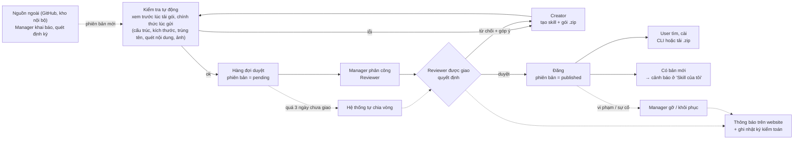
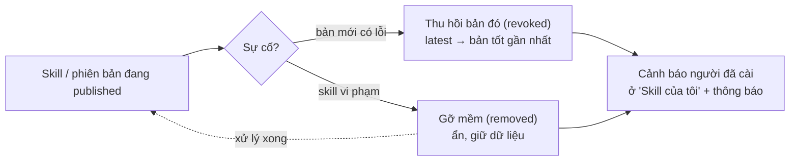
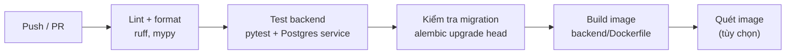
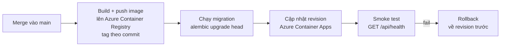

# Pipeline – Vita-skill

> Trạng thái: **đề xuất.** Repo chưa có CI/CD (không có `.github/`); phần 2–3 là thiết kế mục tiêu dựa trên `Makefile`, `docker-compose` và `deploy/` đã dựng khung.

Có hai pipeline: (1) quy trình nghiệp vụ của một skill, (2) pipeline build–kiểm tra–triển khai của chính website.

## 1. Pipeline nghiệp vụ: từ skill tới người dùng

| Bước | Module backend | Kết quả |
|---|---|---|
| Tạo, tải gói lên (kèm kiểm tra xem trước) | `skills` | Bản `draft`, `validation_results` với `phase = preview`, dữ liệu điền sẵn |
| Gửi duyệt và kiểm tra tự động (đồng bộ trong `submit`) | `skills` (service) | `validation_results`; không có `fail` → `pending`, vào hàng đợi `reviews`; có `fail` → trả về `draft` |
| Phân công người duyệt | `reviews` | `assigned_to`, thông báo Reviewer, ghi `audit_logs` |
| Duyệt / từ chối | `reviews` | Bản ghi review, đổi trạng thái, thông báo cho Creator, ghi `audit_logs` |
| Cấp SAS URL tải gói | `skills` | `download_count` (zip) hoặc chỉ cấp URL (install) |
| Cài | `installs` | Ghi nhận bản đã cài (CLI báo về) |
| Cảnh báo cập nhật | `installs` | So sánh `installed_version` với bản mới nhất |
| Gỡ, thu hồi, chuyển quyền, khôi phục | `admin` | Đổi trạng thái / chủ sở hữu, ghi `audit_logs`, thông báo chủ skill và người đã cài |
| Duyệt / gộp tag | `admin` | Tag `approved`/`rejected`, ghi `audit_logs`, thông báo Creator |
| Đổi phạm vi xem (mở rộng) | `skills` → `reviews` | `visibility_request`, vào hàng đợi, phân công, duyệt như phiên bản |

Các trạng thái `draft`, `validating`, `pending`, `published`, `rejected`, `revoked` trong sơ đồ là của **phiên bản** (xem architecture.md, mục 7). Chỉ phiên bản `published` mới hiện ra cho User; phiên bản mới của skill đã đăng phải qua duyệt lại, bản cũ vẫn phục vụ trong lúc chờ.

### Nhánh sự cố (Manager)

Hệ thống chỉ **cảnh báo**, không tự thay đổi bản đã cài trên máy người dùng.

## 2. Pipeline phát triển & CI (đề xuất)

Chạy trên mỗi pull request vào `main`.

| Giai đoạn | Lệnh gợi ý | Điều kiện qua |
|---|---|---|
| Lint | `ruff check backend && ruff format --check backend` | Không lỗi |
| Type check | `mypy backend/app` | Không lỗi |
| Test | `pytest backend/tests` | Tất cả pass |
| Migration | `alembic upgrade head` trên DB trống, rồi `alembic check` | Không lệch model |
| Build | `docker build -f backend/Dockerfile backend` | Build thành công |

Nên bọc các lệnh trên vào `make lint`, `make test`, `make build` trong `Makefile` để local và CI dùng chung.

### CI cho frontend (D34)

Chạy khi `frontend/**` thay đổi.

| Giai đoạn | Lệnh gợi ý | Điều kiện qua |
|---|---|---|
| Cài | `npm ci` | Thành công |
| Lint & type check | `npm run lint`, `npm run typecheck` | Không lỗi |
| Test | `npm test` (Vitest) | Tất cả pass |
| i18n | Script so khoá của `vi.json` và `en.json` | Hai file đủ khoá như nhau |
| Build | `npm run build` | Tạo được `dist/` |

### CI cho CLI (D29)

Thư mục `cli/` có pipeline riêng, chỉ chạy khi `cli/**` thay đổi.

| Giai đoạn | Lệnh gợi ý | Điều kiện qua |
|---|---|---|
| Cài | `npm ci` | Thành công |
| Lint & type check | `npm run lint`, `npm run typecheck` | Không lỗi |
| Test | `npm test` (có test giải nén, kiểm tra checksum, chặn path traversal) | Tất cả pass |
| Đóng gói | `npm pack` | Tạo được `.tgz` |
| Phát hành | `npm publish` lên kho nội bộ, khi gắn tag `cli-vX.Y.Z` | Chỉ từ nhánh `main` |

Nên chạy CLI test trên Linux, macOS và Windows vì đường dẫn và thư mục cài khác nhau theo hệ điều hành.

## 3. Pipeline triển khai (CD, đề xuất; Azure)

| Bước | Ghi chú |
|---|---|
| Tag image | Dùng commit SHA, không dùng `latest` để rollback được |
| Migration | Chạy **trước** khi bật backend mới; migration phải tương thích ngược một phiên bản |
| Frontend | `npm run build` ra `dist/`, đóng vào image nginx cùng lần deploy; nginx có cấu hình trả `index.html` cho đường dẫn của SPA |
| Smoke test | Dùng `/api/health` và `/api/health/ready` (chưa có, thêm vào `main.py`) |
| Rollback | Container Apps giữ các revision cũ, chuyển lưu lượng về revision trước; nếu có migration phá vỡ thì `alembic downgrade` thủ công |
| Bí mật | Lấy từ Key Vault qua Managed Identity, không nằm trong repo (gồm client secret Entra ID) |
| Hạ tầng | Mô tả bằng IaC (Bicep hoặc Terraform) để không phụ thuộc thao tác tay trên Azure portal |
| Gói skill | Nằm trong Blob Storage, không nằm trong image; không bị ảnh hưởng khi deploy |
| Tác vụ định kỳ (D28, D46) | Azure Container Apps *Job* dùng cùng image backend, cập nhật cùng lần deploy; chạy mỗi giờ trong giờ làm việc để tự chia việc, đánh dấu quá hạn, dọn bản nháp cũ, xoá nhật ký quá hạn; một job quét nguồn thu thập chạy riêng theo lịch (mặc định mỗi ngày) vì có thể chạy lâu |

## 4. Môi trường

| | Local | Production |
|---|---|---|
| Chạy bằng | `docker-compose.yml` | Azure Container Apps (`deploy/docker-compose.prod.yml` dùng làm tham chiếu cấu hình) |
| Cấu hình | `.env` (từ `.env.example`) | Biến môi trường + Key Vault |
| DB | Container Postgres cục bộ | Azure Database for PostgreSQL, có backup |
| Gói skill | Azurite cục bộ | Azure Blob Storage |
| Đăng nhập | Ứng dụng Entra riêng cho dev (redirect `localhost`) | Ứng dụng Entra production |
| Nginx | Tùy chọn | Bắt buộc (`deploy/nginx/default.conf`) |
| Frontend | `vite dev` có proxy `/api` tới backend | File build trong image nginx |
| Tác vụ định kỳ | Chạy tay bằng lệnh nội bộ | Container Apps Job |

## 5. Việc cần làm để pipeline chạy được

1. Điền `Makefile` (hiện rỗng) với các target `up`, `down`, `lint`, `test`, `migrate`, `build`.
2. Điền `docker-compose.yml`, `deploy/docker-compose.prod.yml`, `backend/Dockerfile`, `deploy/nginx/default.conf` (hiện rỗng).
3. Thêm workflow CI (ví dụ `.github/workflows/ci.yml`) theo phần 2: backend, frontend và CLI, mỗi phần chỉ chạy khi thư mục tương ứng thay đổi.
4. Thêm endpoint `/api/health` và `/api/health/ready`.
5. Viết test đầu tiên trong `backend/tests/`.
6. Viết IaC và bước deploy lên Azure (Container Apps, ACR, PostgreSQL, Blob, Key Vault).
7. Tạo thư mục `cli/` (Node.js) và nhờ IT tạo feed npm nội bộ để publish; thêm workflow CI cho CLI theo mục 2.
8. Đăng ký ứng dụng trong Entra ID (dev + prod; một cho website, một cho CLI), tạo các nhóm vai trò và gán nhóm cho ứng dụng; lấy tenant ID, client ID, client secret.
